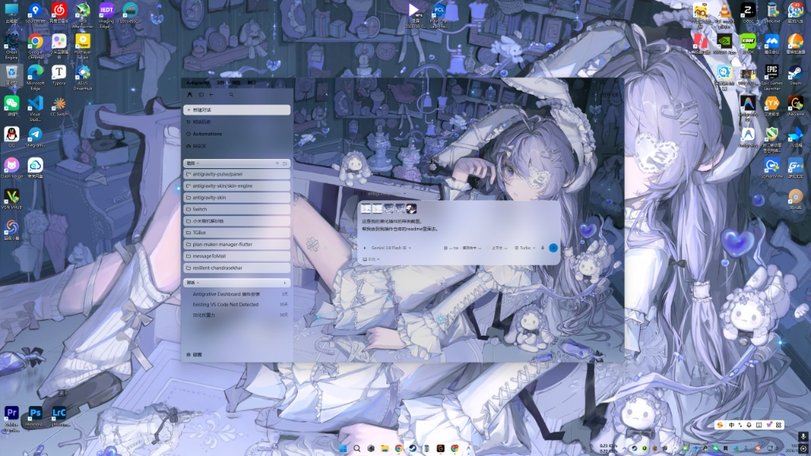
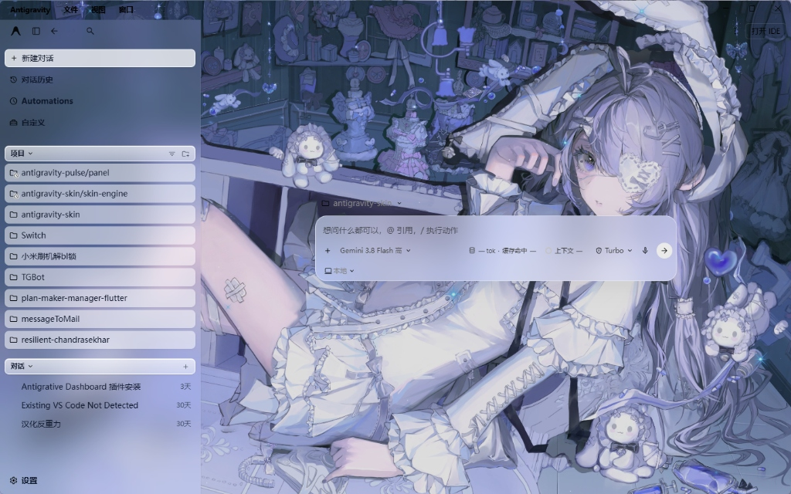
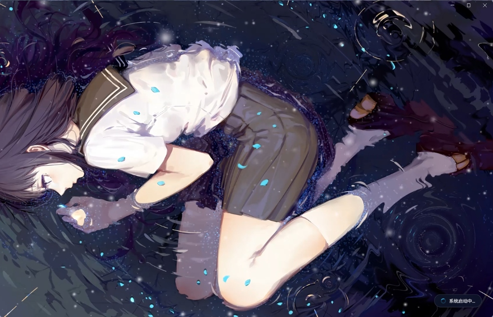
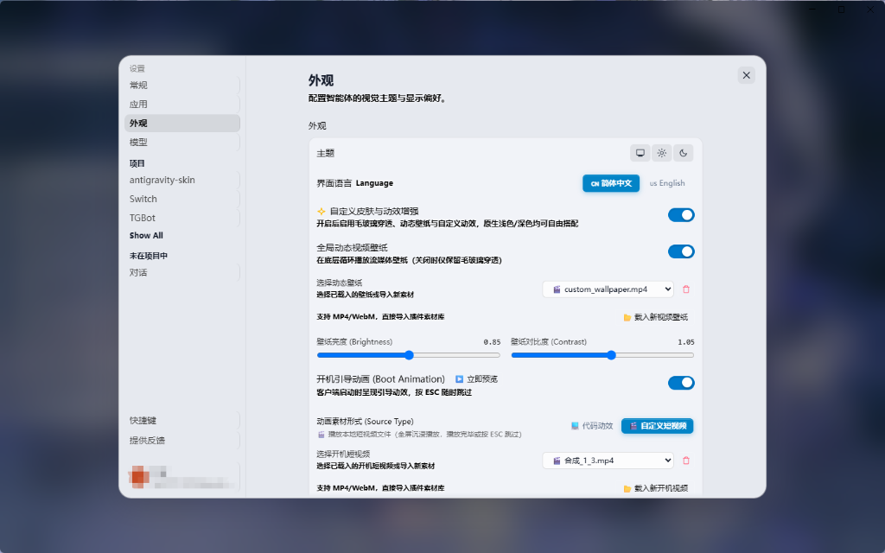

# Antigravity Skin & Theme 官方无感集成插件

<p align="center">
  
  
  
  
  
</p>

> **无缝集成、体验极致** 的 Google Antigravity 主题、动态视频壁纸、自定义开机引导动效与原生外观设置菜单集成插件。（**macOS 平台保持 100% 纯净零改包免侵入**；**Windows 平台提供专属开机防白闪深度增强，并支持一键无损还原**）

---

## 🖼️ 效果图预览 (Showcase)

> 💡 **搭配灵感 · 小红车 (Wallpaper Engine) 联动玩法**：
> 想要打造浑然一体的梦幻沉浸式桌面？
> 可以在 Steam **Wallpaper Engine（小红车）** 中挑选喜欢的视频壁纸（MP4 / WebM 格式），然后在 Antigravity「设置 - 外观」中直接载入。当反重力客户端与 Windows 桌面使用同款壁纸时，配合插件的全局毛玻璃通透穿透效果，窗口仿佛与桌面融为一体，带来极致的沉浸美感！

### 1. 桌面协同融合（配合 Wallpaper Engine 动态壁纸）
> 客户端窗口全局毛玻璃与桌面动态壁纸完美对准，边栏与气泡半透明悬浮，浑然天成。

<p align="center">
  
</p>

### 2. 工作台主界面与动态壁纸穿透
> 无论是左侧项目栏、对话历史还是核心提问面板，均呈现晶莹的毛玻璃质感，底盘动态循环流动。

<p align="center">
  
</p>

### 3. 全屏沉浸式开机引导动画
> 彻底移除官方原版呼吸遮罩，启动时呈现丝滑全屏短视频或极客代码动效，支持按 `ESC` 随时跳过与平滑溶入主界面。

<p align="center">
  
</p>

### 4. 官方原生「设置 - 外观」无缝集成控制面板
> 直接在官方外观设置中一键载入壁纸素材、微调亮度与对比度滑块、切换开机动画方案，即调即显。

<p align="center">
  
</p>

---

## 🌟 核心特性概览

### 1. 官方原生「设置 - 外观」无缝集成
- **原生第四主题模式**：直接在 Antigravity「设置」->「外观」的原生“主题”单选组中无缝注入 **「✨ 自定义」** 选项，与官方原生「系统」、「浅色」、「深色」并列。
- **纯净双向退回**：切换为官方「系统 / 浅色 / 深色」时，**100% 干净卸载**所有自定义样式并停止视频壁纸，彻底恢复官方原生黑白界面；切换为「✨ 自定义」时自动展开个性化控制台。
- **设置面板高对比度控件**：全面重构开关与滑块视觉效果，在浅色与深色背景下均清晰醒目。

### 2. 全局动态视频壁纸与毛玻璃穿透
- **本地流媒体分块加速**：内置基于 HTTP Range 分块响应的视频流媒体服务，支持视频进度任意跳转拖拽，超低 CPU 与内存占用。
- **全局毛玻璃透明穿透**：左侧边栏、主工作区、对话气泡、消息输入框、状态栏、辅助侧边栏深度透明穿透。
- **多素材自定义**：支持内置动态视频，亦可一键填入**本地任意 MP4/WebM 视频绝对路径**或**网络在线视频链接**。
- **实时无级滤镜调节**：支持亮度（Brightness）、对比度（Contrast）滑块实时无级微调，调节时画面完全不中断。
- **展陈几何自适应（彻底无黑边）**：素材的定位与填充由独立几何控制器以最高优先级内联接管，窗口缩放、分屏、全屏、高 DPI 切换均实时跟随；提供 `铺满裁切 / 模糊填充 / 完整显示 / 拉伸铺满` 四种策略与九宫格裁切重心，默认「铺满裁切」可保证**任何比例素材都不出现黑边**。
- **用户对话气泡折叠增强**：长文本提问气泡智能限高并提供一键折叠/展开按钮。

### 3. 可定制开机引导动画（真·零延迟动态联动 & 影院级溶出）
- **官方 Logo 呼吸彻底移除（Windows 专属增强）**：彻底解除官方反重力呼吸 Logo 遮罩，直接动态联动呈现您在「设置 - 外观」中配置的专属开机动画（短视频或科技代码）。
- **零白闪平滑溶出（Cross-Dissolve）**：底层深度探测主工作台 DOM 与动态壁纸真实就绪状态后才提示「就绪」，点击跳过后通过 450ms 贝塞尔曲线自然溶入主界面，无缝衔接。
- **两套素材方案独立下拉切换（不管底层文件物理路径）**：
  - 🎬 **短视频开机方案**：内置独立视频下拉库，支持导入 MP4/WebM，直接通过下拉框在多个视频间自由切换。
  - 💻 **代码渲染动效方案**：内置极客科技动效预设与独立脚本下拉库，支持导入任意 Canvas / WebGL / DOM 渲染脚本，通过下拉框在各个代码动效方案间自由切换。
  - 两种模式下拉框完全独立，互不混杂，提供素材一键上传与安全删除管理。
- **即时交互与安全退出**：全屏播放期间随时按 `ESC` 键或点击屏幕跳过；内置「▶️ 立即预览」按钮，随时试看效果。

### 4. Wallpaper Engine / WallpaperMachine 外部素材库（零拷贝原地引用）
- **双通道独立开关**：动态壁纸与开屏动画各有一个「使用 Wallpaper 素材库」开关，任意组合都合法。开启后自动隐藏该维度的原生「选择 / 载入 / 删除」入口，只保留「当前素材 · 使用中」摘要；关闭则完整恢复插件原本的载入与素材管理。任一开关开启时，素材库区块固定出现在「插件版本与在线热更新」下方。
- **零拷贝、零冗余**：直接以绝对路径原地引用本地已下载的 Wallpaper Engine 创意工坊素材（Steam `431960`）或 WallpaperMachine 素材库，**绝不复制任何视频/图片到插件目录**，磁盘占用零增加。
- **三种形态全支持**：`🎬 video`（MP4/WebM 原生硬件解码）、`🌐 web`（HTML5/JS/WebGL 沙箱 iframe，静态资源经 Sidecar 安全托管）、`🎨 scene`（高清封面 + Ken Burns 微视差呼吸动效，支持内嵌氛围音）。
- **年龄分级筛选**：内置 `G 所有人 / PG-13 辅导级 / R-18 限制级` 三档，语义对齐 WallpaperMachine——默认全选不筛选，取消勾选即隐藏该档，偏好本地记忆。
- **严格安全过滤**：`application` 类型与 `.exe` 入口在扫描阶段即被拦截，永不载入、永不执行；所有文件读取均限制在已挂载的素材库白名单内，并做目录穿越防护。
- **双模式载入**：支持「📁 挂载素材库根目录」全量索引（含 Steam 库路径自动探测）与「📄 载入单个壁纸包」，粘贴路径回车即可挂载，即时展示资产卡片（封面 / 标题 / 类型徽章 / 体积）。
- **双色选中态**：卡片外框随用途配色——`设为动态壁纸` 为天蓝、`设为开屏动画` 为翠绿；同一张素材两者都用时呈现蓝绿渐变描边与双胶囊标记，一眼看清当前占用。

### 5. 深度隔离中文化引擎
- 内置隔离汉化引擎，智能汉化官方常用菜单、侧边栏与提示文案。
- **代码与终端严格隔离**：采用容器级回溯检测，自动规避代码块（`<pre>`, `<code>`）、Monaco/Ace 代码编辑器与终端输出，绝不污染代码原文。
- 汉化选项直接内嵌至外观设置卡片下方，支持一键热开关。

### 6. 官方 Sidecar 伴生架构与跨平台双引擎设计
- **核心功能依托官方持久化规范**：主体功能（动态视频壁纸、毛玻璃穿透、外观控制台注入、在线热更新）基于 Antigravity 官方持久化插件规范与 Sidecar 伴生守护进程运行，核心代码与用户素材独立保存在用户目录（`.gemini/config/plugins`）中。
- **实事求是的跨平台开机引导策略**：
  - **🍎 macOS 端（100% 纯净零改包）**：恪守苹果 Gatekeeper 严格代码签名机制，**绝对不解包或修改 `app.asar`**，完全由 Sidecar 守护进程通过 Chromium CDP 事件在毫秒级无感隐匿原生呼吸遮罩；
  - **🪟 Windows 端（深度防白闪补丁 + 随时一键还原）**：针对 Windows 下 Chromium 启动瞬间硬编码呼吸遮罩造成的闪白顽疾，安装脚本内置针对 `app.asar` 启动遮罩的轻量优化补丁（`patch-loading.bat`），实现极致的无白闪平滑溶出，并配套提供 `restore-loading.bat` 随时一键完整恢复官方原厂状态。
- **长连接持久巡检**：CDP 通道保持长效保活，页面重载、导航或热更新时自动无感补注皮肤，防止主题掉落。
- **优雅退出**：客户端关闭时自动注销清理进程与端口，杜绝僵尸进程占用资源。

### 7. 客户端内一键在线热更新（跨平台：Windows & macOS）
- **免手动重复下载与安装**：在「设置 - 外观」控制面板底部直接点击「🔄 检查更新」，自动对接 GitHub Releases 获取最新发布与更新说明。
- **真·无感热重载**：点击「🚀 立即热更新」后，后台自动流式下载并安全部署核心代码，通过 CDP 实时热替换客户端样式与逻辑，**无需退出客户端**即刻生效。
- **用户数据绝对安全**：白名单增量更新严格保留本地个性化配置（`config.json`）与所有自定义壁纸/开机素材，绝无被覆盖丢失的风险。
- **网络镜像双保险**：内置 GitHub Releases 官方开放 API、jsDelivr CDN 兜底节点与国内镜像下载加速，保障各地区极速升级。


---

## 🚀 安装步骤（三种方式任选其一）

### 方式一：下载 Release 压缩包一键安装（推荐，免 Git）
1. 前往 GitHub 仓库右侧的 [Releases](../../releases) 下载最新版的 `antigravity-skin.zip`。
2. 将压缩包解压到任意位置（如桌面或下载文件夹）。
3. 执行一键安装：
   - **Windows**：直接**双击运行 `install.bat`**。（或右键使用 PowerShell 运行 `install.ps1`）
   - **macOS / Linux**：在终端进入解压目录，运行：
     ```bash
     chmod +x install.sh
     ./install.sh
     ```
4. 安装完成后，**彻底退出并重新启动 Antigravity 客户端**即可！
   *(提示：安装成功后，解压出来的文件夹可以直接删除)*

---

### 方式二：终端一行命令极速在线安装（免手动下载）
无需手动下载压缩包，直接在终端中粘贴并回车：

- **Windows (PowerShell)**：
  ```powershell
  irm https://raw.githubusercontent.com/MrcolorH/antigravity-skin/main/install.ps1 | iex
  ```

- **macOS / Linux (Terminal)**：
  ```bash
  curl -fsSL https://raw.githubusercontent.com/MrcolorH/antigravity-skin/main/install.sh | bash
  ```

---

### 方式三：从源码仓库安装（适合开发者）
如果您已经通过 `git clone` 将本仓库克隆到了本地：

- **Windows**：直接双击 `install.bat` 或在 PowerShell 执行 `.\install.ps1`。
- **macOS / Linux**：终端执行 `./install.sh`。

---

### 🎬 跨平台开机动画联动配置（Windows & macOS）

- **🍎 macOS 平台（原生纯净非侵入式架构）**：
  - **一步到位，零指令额外操作**：只需执行一次 `./install.sh`（或一行在线命令），脚本会自动关闭 Antigravity 客户端、完成部署并**自动重新启动客户端**！
  - **100% 保持官方代码签名**：绝不解包或篡改 `app.asar`，完全避免 macOS Gatekeeper / Hardened Runtime 签名损坏导致的白屏或死锁；
  - **动态消除原生 Loading 遮罩**：Sidecar 守护进程通过 Chromium CDP 事件驱动在毫秒级无感隐藏官方呼吸 Logo 遮罩，并将背景纯黑无缝过渡至渲染层的开机视频，体验如丝般顺滑！

- **🪟 Windows 平台（支持深度 Asar 补丁与非侵入式双模式）**：
  - **全自动退出与重启**：运行 `install.bat` / `install.ps1` 会自动退出客户端，并在部署完成后自动重新拉起生效；
  - **可选独立补丁与还原**：如需手动合入或还原官方原版，可随时双击 `patch-loading.bat` / `restore-loading.bat`。

---

## ⚙️ 如何在客户端中个性化设置

安装生效后，主题已与 Antigravity 原生设置融为一体：

1. 点击 Antigravity 左侧导航栏底部的 **⚙️ 设置（Settings）** 图标。
2. 切换至 **外观（Appearance）** 标签页。
3. 在顶部的 **「主题 (Theme)」** 选项中，点击 **「✨ 自定义」**。
4. 此时下方将展开专属控制台：
   - **动态视频壁纸**：一键开启或关闭；
   - **壁纸素材库与一键载入**：
     - 点击 **「📁 载入新视频壁纸」** 即可选取任意本地 `.mp4` / `.webm` 格式视频（**小红车 Wallpaper Engine 中的视频壁纸可直接在此载入**）；
     - 导入后自动纳入插件素材库，随时可通过下拉菜单自由切换；
   - **亮度 / 对比度调节**：拖动滑块实时无级微调毛玻璃透光度与对比反差；
   - **开机引导动画**：自由选择【代码动效】或【自定义短视频】，支持载入新开机短视频与一键「▶️ 立即预览」；
   - **界面语言 (Language)**：自由切换中文（增强汉化）与默认英文。
5. 所有的调整均**实时生效**，并自动持久化保存，下次启动客户端自动应用。

---

## 🗑️ 彻底卸载（支持本地与一行命令）

如果您希望卸载本插件并恢复纯官方初始环境：

### 1. 终端一行指令在线卸载（最方便）
- **macOS / Linux**：
  ```bash
  curl -fsSL https://raw.githubusercontent.com/MrcolorH/antigravity-skin/main/uninstall.sh | bash
  ```
- **Windows (PowerShell)**：
  ```powershell
  irm https://raw.githubusercontent.com/MrcolorH/antigravity-skin/main/uninstall.ps1 | iex
  ```

### 2. 本地脚本卸载
- **Windows**：双击运行 `uninstall.bat`（或在 PowerShell 中执行 `.\uninstall.ps1`）。
- **macOS / Linux**：终端执行 `./uninstall.sh`。

脚本会自动从官方插件目录安全移除插件并清理配置文件。重启 Antigravity 即可完全恢复。

---

## 📦 项目代码结构

```text
antigravity-skin/
├── plugin.json                 # Antigravity 官方插件清单声明
├── config.default.json         # 出厂默认配置
├── install.bat                 # Windows 双击一键安装脚本
├── uninstall.bat               # Windows 双击一键卸载脚本
├── install.ps1                 # Windows PowerShell 自动部署脚本
├── uninstall.ps1               # Windows PowerShell 自动清理脚本
├── install.sh                  # macOS / Linux 一键安装脚本
├── uninstall.sh                # macOS / Linux 一键卸载脚本
├── patch-loading.bat           # Windows 前置开机动画防闪白溶出引擎升级脚本
├── restore-loading.bat         # Windows 一键安全恢复官方原厂开机状态脚本
├── sidecars/
│   └── skin-engine/
│       ├── sidecar.json        # 官方 Sidecar 服务声明配置
│       ├── main.mjs            # 守护进程（流媒体 Range 服务 + CDP 长连接注入 + 状态自愈）
│       └── wallpaper-library.mjs # 外部素材库解析引擎（project.json / 扫描缓存 / 白名单 / 静态伺服）
├── client/                     # 客户端渲染层代码
│   ├── index.js                # 客户端总控中心与配置桥接
│   ├── modules/
│   │   ├── appearance-menu.js  # 原生外观设置卡片深度无缝注入
│   │   ├── wallpaper-library-ui.js # 外部素材库资产中心（卡片网格 / 筛选 / 双向应用）
│   │   ├── wallpaper.js        # 多形态壁纸渲染器（video / web iframe / scene 海报）与毛玻璃
│   │   ├── boot-animation.js   # 视频 / 场景封面 / 代码三类全屏开机动画引擎
│   │   ├── i18n-engine.js      # 智能防污染中文隔离汉化引擎
│   │   └── crt-theme.js        # 复古 CRT 特效模块
│   └── styles/
│       ├── glass-theme.css     # 深度毛玻璃与窗口穿透核心样式
│       └── crt-theme.css       # 复古扫描线样式
├── scripts/
│   ├── install.mjs             # 跨平台纯净白名单部署与 RPC 注册引擎
│   ├── uninstall.mjs           # 跨平台安全卸载引擎
│   ├── patch-boot-overlay.mjs  # 跨平台核心开机引擎与原生窗口锁黑补丁 (Win & macOS)
│   ├── restore-boot-overlay.mjs# 跨平台官方 app.asar 自动还原脚本 (Win & macOS)
│   └── pack.mjs                # 一键构建 GitHub Release 压缩包脚本
└── assets/
    ├── scripts/
    │   └── default-boot.js     # 内置极客科技开机引导代码动效预设
    └── videos/                 # 本地视频素材管理库（支持随时载入/删除 MP4/WebM）
```

---

## 🤝 交流反馈与参与共建 (Feedback & Contributing)

非常欢迎大家体验使用并提供宝贵的意见与灵感！
- **遇到问题或有优化建议**：欢迎前往 [Issues](https://github.com/MrcolorH/antigravity-skin/issues) 提交反馈，我们会持续快速跟进与迭代优化；
- **参与开发与特性贡献**：热烈欢迎大家多多提交 [Pull Requests (PR)](https://github.com/MrcolorH/antigravity-skin/pulls)！无论是动效素材扩展、毛玻璃细节打磨、隔离汉化词条补充还是性能优化，期待与大家一同共建更好看、更好用的 Antigravity！

---

## 📄 开源许可证

本项目基于 [MIT License](LICENSE) 开源发布。

