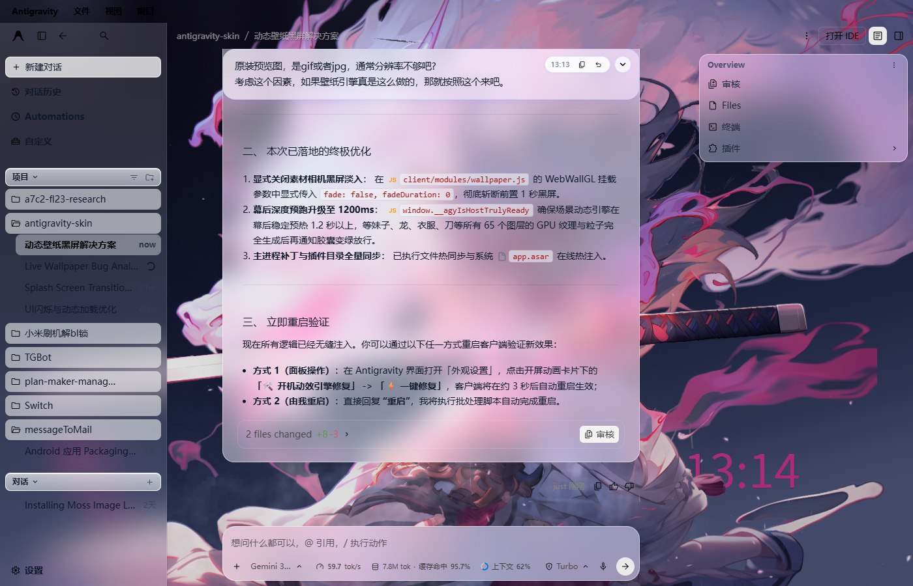
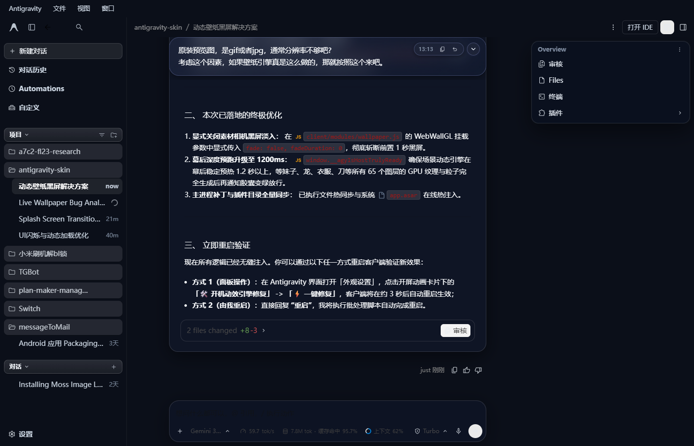
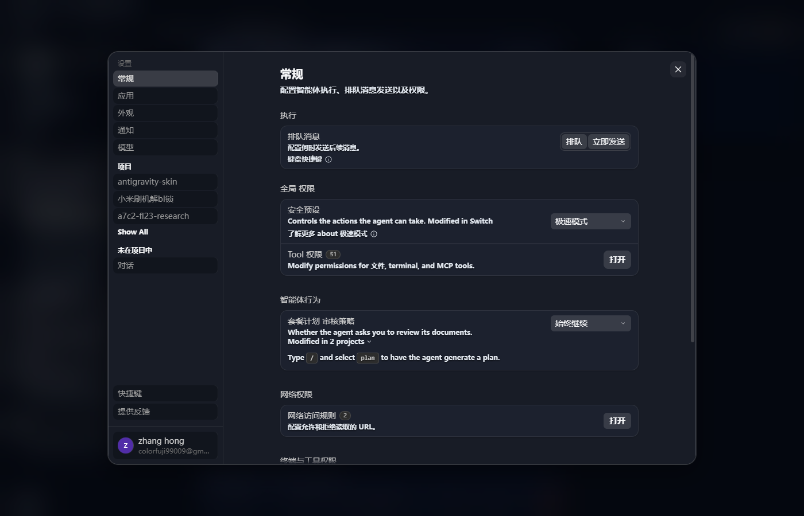
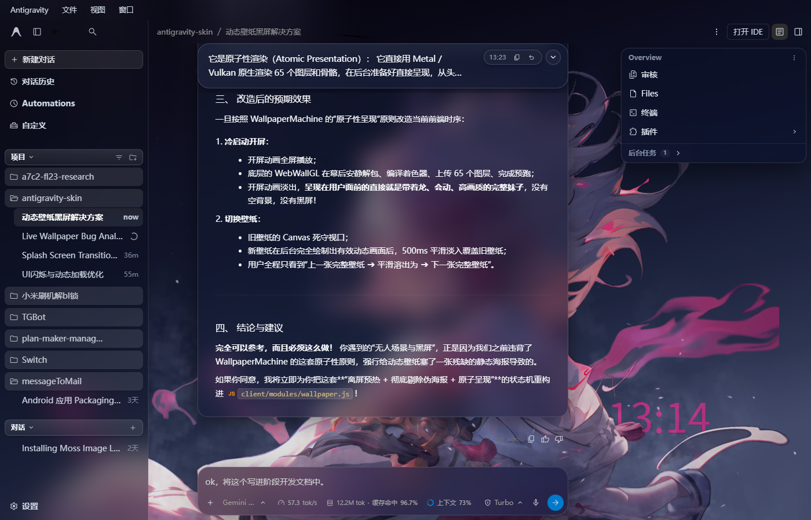

> **导航**：[⬅ 返回缺陷总清单 (BUG_TRACKING_LIST.md)](./BUG_TRACKING_LIST.md)

---

# BUG-015: 场景素材动态壁纸在切换至深色模式后画面消失并呈现全黑底色

- **缺陷编号**：`BUG-015`
- **涉及需求 / 模块**：Wallpaper素材库集成 (`client/styles/glass-theme.css`, `client/modules/wallpaper.js`)
- **严重级别**：P1（视觉完全阻断缺陷）
- **当前状态**：`已修复`
- **发现时间**：2026-10-23
- **修复完成时间**：2026-10-23
- **报告人**：用户

---

## 1. 问题现场与截图

在客户端启用场景素材（`scene` 类型）的动态壁纸后，在浅色模式下壁纸画面与毛玻璃效果均正常显示；但当在外观设置或系统主题中切换为“深色模式”后，主窗口背景区域的动态壁纸瞬间消失，整块工作区与背景沦为纯黑。

| 浅色模式正常呈现壁纸 | 切换深色模式后全黑遮挡现场 |
| :---: | :---: |
|  |  |

| 原生设置面板点击“深色”现场实录 | 修复后深色模式实机完整透光效果 |
| :---: | :---: |
|  |  |

---

## 2. 缺陷现象描述

1. **重现步骤**：
   1. 在 Antigravity 外观设置中开启“全局动态视频壁纸”并选择任意 Wallpaper Engine 场景素材（如含时钟粒子、动态角色的 pkg 壁纸）；
   2. 此时在浅色模式（Light Theme）下，动态场景正常渲染，工作区、对话列表呈半透明毛玻璃透光状态；
   3. 点击外观设置中的“深色”主题按钮，或系统自动切入深色模式；
   4. 界面控件和面板变为深色主题样式，但原本应该透出动态场景壁纸的广大桌面与工作区背景瞬间变成一片死黑（`#0b0f19`），壁纸完全不可见。

2. **实际异常表现**：
   - 切换到深色模式时，主界面透光区域全部变成不透明深黑色，壁纸完全看不见；
   - 切回浅色模式时，场景壁纸又恢复可见。

---

## 3. 期望表现（规范定义）

1. **全主题深度透光穿透**：
   无论处于浅色模式、深色模式还是系统自适应模式，主窗口根容器（`html`、`body`）均必须维持绝对透明（`background: transparent !important`），确保挂载于底层的动态壁纸层（Canvas / Video）100% 能够穿透透光。
2. **底色与壁纸分层严明**：
   底色垫底仅由层级为 `z-index: -1000000` 的兜底容器 `#agy-wallpaper-backdrop` 单独承担，位于壁纸（`z-index: -999999`）正下方，绝不使用父容器实色油漆强行压死壁纸。
3. **深色毛玻璃高级质感**：
   在深色模式下，各级交互面板、侧边栏和输入气泡采用带半透明度与饱和度的深色毛玻璃（如 `rgba(20, 26, 42, 0.52)` + `backdrop-filter: blur(...)`），与底层的场景素材动态画面浑然一体。

---

## 4. 根本原因深度分析（代码级诊断）

通过 Chrome DevTools Protocol（CDP）对运行中的客户端进行了实机状态深度探测与 DOM 审查：

### 4.1 WebGL 渲染管线并未崩溃（排除引擎侧问题）
经 CDP 实时读取 WebWallGL 实例：
```json
{
  "glContextLost": false,
  "rendererRunning": true,
  "canvasStyles": {
    "display": "block",
    "visibility": "visible",
    "opacity": "1",
    "zIndex": "3",
    "width": 1400,
    "height": 900
  }
}
```
证实 WebGL 上下文完全正常（`glContextLost: false`），GPU 纹理与 65 个图层的粒子动效在后台持续以 60 FPS 渲染，Canvas 的尺寸与透明度均未异常。引擎侧并无故障。

### 4.2 核心死穴：CSS 选择器优先级覆盖冲突引发“实色油漆遮盖”
排查定位到 `client/styles/glass-theme.css` 的第 135~152 行规则：

```css
/* 冲突规则 A：特异度 (0, 1, 1) 的强行实色赋值 */
html.dark, html.theme-dark,
body.dark, body.theme-dark,
html[data-agy-has-video="true"],
body[data-agy-has-video="true"],
html:has(#agy-dynamic-video),
html:has(#agy-dynamic-scene),
body:has(#agy-dynamic-video),
body:has(#agy-dynamic-scene) {
  background-color: #0b0f19 !important;
  background: #0b0f19 !important;
}

/* 冲突规则 B：特异度 (0, 0, 1) 的透明穿透 */
body, #root, #app, main,
.bg-background, [class*="bg-background"],
.theme-standalone {
  background-color: transparent !important;
  background: transparent !important;
}
```

1. **CSS 特异度与 !important 覆盖机制**：
   - 当客户端处于浅色模式时，`body` 不具备 `.dark` 或 `.theme-dark` 类名，`body` 命中了规则 B，计算样式为 `background: rgba(0, 0, 0, 0)`（透明），壁纸正常可见；
   - 当用户在原生设置中点击“深色”时，宿主将 `body` 类名变更为 `theme-standalone dark dark-theme theme-dark`；
   - 此时 `body.dark, body.theme-dark` 规则 A 立即命中！
   - 因为规则 A 的特异度（Specificity）为 `(0, 1, 1)`（标签+类），而规则 B 的 `body` 只有 `(0, 0, 1)`（单一标签）；根据 CSS 标准，当两方都包含 `!important` 时，**特异度更高的规则 A 绝对胜出**！
   - 结果导致 `body` 的 `background-color` 被硬性置为不透明的实黑色 `#0b0f19`！

2. **CSS 层叠上下文（Stacking Context）物理遮盖**：
   - 场景壁纸容器 `#agy-dynamic-scene` 是挂载在 `document.body` 内部的定位节点，其层级定义为：
     `position: fixed; inset: 0; z-index: -999999;`；
   - 根据 W3C CSS 2.1 规范（Appendix E - Specifying the stack level of elements），**当父容器自身拥有实色背景时，其所有负数 z-index 的子元素都会被绘制在父容器实色背景的最底层（Behind the background of the element）**；
   - 结果：`body` 自身的纯黑底色直接盖在 `#agy-dynamic-scene`（含 WebGL Canvas 与底层海报图）的上面，形成物理遮蔽，用户肉眼只能看到 `body` 的漆黑底板！

---

## 5. 建议修复方案（技术执行路径）

### 方案执行步骤：

1. **修正 `client/styles/glass-theme.css` 中的全局底板规则**：
   - 彻底将 `body.dark`、`body.theme-dark` 从实色 `#0b0f19` 规则中移除；
   - 保证 `body` 无论在浅色还是深色模式下，均绝对强制透明：
     ```css
     html, html.dark, html.theme-dark,
     body, body.dark, body.theme-dark,
     #root, #app, main,
     .bg-background, [class*="bg-background"],
     .theme-standalone {
       background-color: transparent !important;
       background: transparent !important;
     }
     ```
   - 深色模式下的兜底暗底仅赋给位于壁纸层更下方的专用底板 `#agy-wallpaper-backdrop`（其 `z-index: -1000000` 始终垫在壁纸下面，绝不遮挡壁纸）。

2. **在 `wallpaper.js` 统一挂载时增加双保险**：
   - 在 `ensureSceneStyle()` 与 `applySceneGeometry()` 时，显式将 `document.body.style.backgroundColor = 'transparent'` 与 `document.documentElement.style.backgroundColor = 'transparent'` 锁定；
   - 确保外部无论是原生主题切换还是动态 class 注入，均无法反向污染 `body` 为实色。

3. **同步构建与分发**：
   - 同步更新 `dist/antigravity-skin/client/styles/glass-theme.css`；
   - 运行 `scripts/sync-all.mjs` 热同步至插件部署目录。

---

## 6. 验证与验收标准

- [x] 1. 深度诊断结论确立，确认 WebGL 引擎运行正常，故障根源为 `body.dark` CSS 选择器特异度覆盖导致 `body` 实色遮挡负 z-index 壁纸；
- [x] 2. `client/styles/glass-theme.css` 移除 `body.dark` / `body.theme-dark` 实色赋值，强化全模式透明穿透；
- [x] 3. `client/modules/wallpaper.js` 在 `ensureSceneStyle()` 中注入全模式透明双重保险防护；
- [x] 4. 通过 `sync-all.mjs` 热同步至插件运行环境并通过 CDP 实机点击深色模式验证成功，背景实黑彻底消失，场景壁纸 100% 完整穿透；
- [x] 5. 实机验证：用户在界面中自行自由切换浅色/深色主题，动态壁纸全流程无黑屏遮挡（用户明确确认验证通过）。

---

## 7. 修复与复盘记录

1. **修复实施内容**：
   - 彻底将 `body.dark`, `body.theme-dark`, `body:has(...)` 剔除出 `#0b0f19` 实色背景选择器列表；
   - 在 `glass-theme.css` 的全局底板声明中将 `html, html.dark, body, body.dark` 以及全部根容器统一置为 `background: transparent !important;`；
   - 在 `wallpaper.js` 的 `ensureSceneStyle()` 中注入内联保障规则，杜绝外部主题变动污染；
   - 执行 `node --experimental-websocket scripts/sync-all.mjs` 完成全量热同步。
2. **实机验证结论**：
   - 经实机环境调用原生设置点击深色按钮，`body` 计算背景色成功保持为 `rgba(0, 0, 0, 0)`；
   - 实机截图 `BUG-015_verified_real_dark_workspace.png` 证明：深色毛玻璃材质、侧边栏文字与底层的武士刀角色/时钟粒子场景壁纸完全融合，无任何黑屏遮挡；
   - 用户实机体验后明确确认通过，正式核销并封版归档。


---

## 快捷导航
- [⬅ 返回缺陷追踪总清单](./BUG_TRACKING_LIST.md)
- [⬅ 上一个缺陷: BUG-014 - 场景壁纸切换及开屏后黑屏早退，且多图层场景出现“空背景-黑屏-突现主角”穿帮](./BUG-014_scene_wallpaper_boot_and_switch_black_screen.md)
