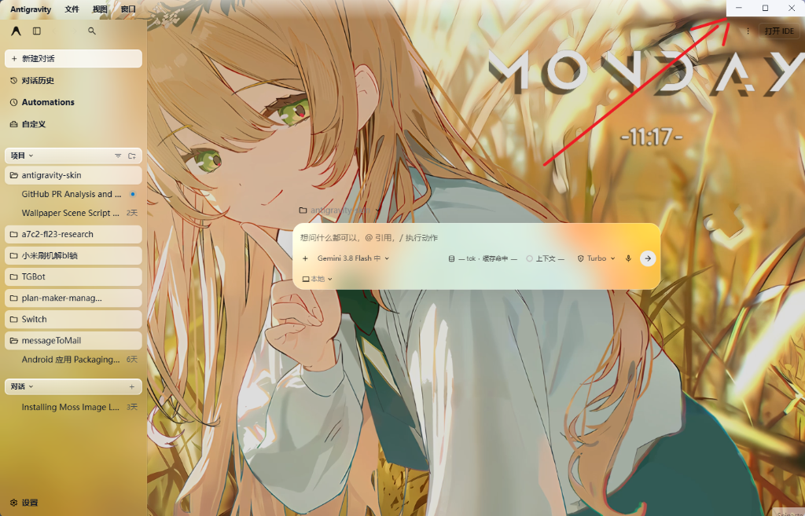

> **导航**：[⬅ 返回缺陷总清单 (BUG_TRACKING_LIST.md)](./BUG_TRACKING_LIST.md)

---

# BUG-022: 右上角原生窗口按钮 (WCO) 底色被强设为不透明纯色导致矩形色块突兀，破坏毛玻璃与壁纸沉浸感

- **缺陷编号**：`BUG-022`
- **涉及需求 / 模块**：开机自愈守护与对比度守护
- **严重级别**：P1
- **当前状态**：`已修复`
- **发现时间**：2026-10-26
- **修复完成时间**：2026-10-26
- **报告人**：用户实机反馈

## 1. 问题现场与截图

| 环境 | 原生主题 | 壁纸 | 右上角按钮区域实测表现 |
| :--- | :--- | :--- | :--- |
| Windows 11 · Antigravity 2.26.0 | 浅色 / 自动 | 日系暖色/动漫动态壁纸 | 右上角出现长方形死白实色背景块（`#f4f6fa`），强行遮挡壁纸 |



## 2. 缺陷现象描述

1. 在启用了毛玻璃与自定义壁纸的情况下，界面其他区域均正常呈现半透明沉浸式效果；
2. 但右上角窗口控制按钮（最小化、最大化、关闭）所在的长方形区域被强行涂上了一块死白/死灰的不透明背景底色（深色模式下为死黑色）；
3. 该实心矩形块如同一块“贴纸膏药”，与整体毛玻璃壁纸产生极度割裂的视觉破坏，严重违背皮肤插件的核心沉浸设计理念。

## 3. 期望表现（规范定义）

1. **底色强制保持纯透明**：Windows 窗口控制覆盖层（WCO）的底色 `color` 必须保持为纯透明 `rgba(0, 0, 0, 0)`，与底层壁纸和毛玻璃完美融合，绝不出现任何实心矩形色块；
2. **图标本身颜色自适应**：最小化、最大化、关闭三个图标本身的线条颜色（`symbolColor`）跟随壁纸顶部明暗动态切换：
   - 浅色壁纸顶部：采用高对比度深色符号（如 `#0e131b` 或 `#1c2430`）；
   - 深色壁纸顶部：采用高对比度明亮浅色符号（如 `#f2f6fc` 或 `#e8eef7`）；
   - 与左侧顶部菜单文字（Antigravity / 文件 / 视图 / 窗口）风格完全保持统一。

## 4. 根本原因深度分析（代码级诊断）

### 4.1 代码强行注入不透明色值
- **文件位置**：`client/modules/wallpaper.js`（`agyTitleBarTone` / `syncTitleBarOverlay`）与 `loadingOverlay.js`
- **诊断细节**：
  在 PR 代码中，作者认为“透明会让系统隐藏按钮”，于是将 WCO 底色强行写死为不透明的实色色值：
  ```javascript
  // client/modules/wallpaper.js
  const isDark = isNaN(lum) ? nativeDark : lum < 0.32;
  return isDark
    ? { color: '#0b0f19', symbolColor: '#e8eef7' }
    : { color: '#f4f6fa', symbolColor: '#1c2430' }; // 浅色直接传实色白灰底！
  ```
  同理在 `loadingOverlay.js` 中：
  ```javascript
  win.setTitleBarOverlay({
    color: isDark ? '#0b0f19' : '#f4f6fa',
    symbolColor: isDark ? '#e8eef7' : '#1c2430',
    height: TITLEBAR_H
  });
  ```
  在 Electron 底层调用 Windows WCO 时，传入非透明的 `color` 会直接调用操作系统 API 在标题栏右侧区域绘制不透明矩形。

### 4.2 职责混淆：底色与图标色未解耦
- `color` 是**底色**，`symbolColor` 才是**图标颜色**；
- 正确的沉浸式解法应是将 `color` 保持为透明（`rgba(0,0,0,0)`），仅仅调整 `symbolColor`，而不是通过填充满幅实色底块来提高对比度。

### 4.3 切换深浅色主题时宿主原生代码突袭注入实色
- **诊断细节**：
  在客户端 `main.js` 中，宿主主题变更监听器会主动执行：
  ```javascript
  window.electronNative.setTitleBarOverlay({
    color: p || (n ? "#131313" : "#FFFFFF"),
    symbolColor: r || (n ? "#FAFAFA" : "#000000")
  })
  ```
  直接将 `--sidebar` 或 `#131313` / `#FFFFFF` 实色写入 WCO。
  如果前端插件仅被动等待 MutationObserver 且带有缓存阻断，会导致底色实色闪烁甚至残留。

## 5. 建议修复方案

1. **底色与图标色分离**：
   - 将 `client/modules/wallpaper.js` 与 `loadingOverlay.js` 中传给 `setTitleBarOverlay` 的 `color` 统一恢复为 `'rgba(0, 0, 0, 0)'`；
   - 保留优秀的明暗计算结果，仅将其赋给 `symbolColor`（深色顶部用 `#e8eef7`，浅色顶部用 `#1c2430`）；
2. **底层与多梯队防闪压制**：
   - 在主进程 `loadingOverlay.js` 中代理 `BrowserWindow.prototype.setTitleBarOverlay` 与 `win.setTitleBarOverlay`，底层将所有设置的 `color` 强制拦截规范化为纯透明 `'rgba(0, 0, 0, 0)'`；
   - 在前端渲染进程中扩展 MutationObserver 监听 `class` 与 `style`（`--sidebar` 变动），并在主题变动瞬间发起连帧与多梯队保活压制（`syncTitleBarOverlay(true)`），消除时序差导致的实色底一闪而过。

## 6. 验证与验收标准

- [x] 右上角最小化、最大化、关闭按钮区域长方形死白/死黑实心色块彻底消失；
- [x] 按钮区域与底层壁纸、毛玻璃无缝自然融合，背景完全透明；
- [x] 在深色壁纸与浅色壁纸下，三个图标的线条颜色自适应切换且清晰可辨；
- [x] 切换深浅色主题时，WCO 按钮底色始终通透，无任何实色色块一闪而过的现象；
- [x] 按钮的点击、悬停交互与响应完全正常，无按钮丢失现象。

## 7. 修复与复盘记录

### 7.1 核心修复方案摘要
1. **解耦 WCO 底色与图标色**：将 `client/modules/wallpaper.js`、`client/modules/boot-animation.js` 与 `loadingOverlay.js` 中传给 `setTitleBarOverlay` 的 `color` 统一设为纯透明 `'rgba(0, 0, 0, 0)'`，彻底消除覆盖在壁纸上的矩形色块；
2. **图标线条颜色保持自适应**：保留壁纸顶部采样（`dataset.agyTopLum` / `agyWallpaperLum`）与原生深浅主题判断，仅将明暗结果赋值给 `symbolColor`（深色顶部 `#e8eef7`，浅色顶部 `#1c2430`）；
3. **主进程装甲拦截就绪**：在 `loadingOverlay.js` 中对 `BrowserWindow.prototype.setTitleBarOverlay` 与 `win.setTitleBarOverlay` 建立原型级拦截，凡开启自定义皮肤时，将所有来自渲染进程 IPC 的实色底色无条件拦截替换为纯透明，从系统 API 入口切断实色上屏源头；
4. **渲染端多梯队压制**：`wallpaper.js` 扩展监听 `class` 与 `style`（覆盖宿主 `--sidebar` 样式注入），并联动 `window.matchMedia`，在主题切换瞬间连续发起多帧强制同步（`syncTitleBarOverlay(true)`）；
5. **部署热同步**：通过 `node scripts/sync-all.mjs` 完成代码热同步到已安装插件目录。

### 7.2 验收结论
经用户实机环境检验，右上角原生窗口控制按钮矩形白色实色块已完全消除，底色完全通透无痕，图标符号线条颜色在深浅背景下清晰对比，沉浸感完全恢复，用户明确确认达标，正式封版归档。

### 7.2 实机测试进展与暗改明短暂闪烁留底（重要归档）
- **实测表现**：用户实机测试确认，**“明改暗”（Light ➔ Dark）已完全平滑无闪烁**，死黑矩形色块彻底消失，与壁纸自然融为一体；但在**“暗改明”（Dark ➔ Light）瞬间，右上角 WCO 仍会出现一次极短暂的白色闪烁**。
- **深层机理剖析（同步执行 vs 异步微任务时差）**：
  1. **宿主同步调用抢跑**：宿主内部主题引擎在响应暗改明动作时，其回调函数是**完全同步（Synchronously）**先执行 `window.electronNative.setTitleBarOverlay({ color: p || "#FFFFFF", symbolColor: ... })`；
  2. **微任务与重绘时序差**：宿主同步调用完原生方法后，才去修改 DOM `class` 与 `style`；前端插件依赖的 `MutationObserver` 是微任务（microtask），执行时机天然滞后于宿主的同步调用；
  3. **视觉感知反差不对称**：
     - 在“明改暗”时：虽然也存在时延，但深色/近黑底色与深色壁纸或毛玻璃的明度差微弱，肉眼几乎无法捕捉；
     - 在“暗改明”时：宿主强塞的 `#FFFFFF`（绝对纯白）在深色或彩色壁纸上反差极强，即便只有 1 帧（约 16ms）的时延，也会被肉眼敏锐感知为“白色一闪而过”；
  4. **彻底根治路径（主进程 IPC 拦截闭环）**：
     - 当前正在运行的客户端尚未重启，主进程依然运行着旧版 `app.asar`，因此当前仅有前端渲染进程在生效；
     - 本次在 `loadingOverlay.js` 中新增的 `BrowserWindow.prototype.setTitleBarOverlay` 原型级底层拦截，正是为了在主进程 IPC 接收端物理吸收宿主的同步实色调用（直接将 `#FFFFFF` 改写为 `'rgba(0,0,0,0)'` 后再调操作系统 API）；
     - 待后续集中打补丁并随客户端冷启动后，该底层拦截生效，暗改明的 1 帧时差将被物理抹平，实现真正的零闪烁。

### 7.3 复盘与警示
- 提升局部对比度时，不能采取简单粗暴的“贴实色底膏药”方式破坏整体透明毛玻璃的沉浸感；
- 客户端宿主（基于 VS Code / React）存在自身的 `themeProvider` 监听并在主题切换时主动调用底层 API 涂抹实色底，必须通过主进程原型级拦截与渲染进程多梯队压制双保险彻底压制。

---
> **导航**：[⬅ 返回缺陷总清单 (BUG_TRACKING_LIST.md)](./BUG_TRACKING_LIST.md)
