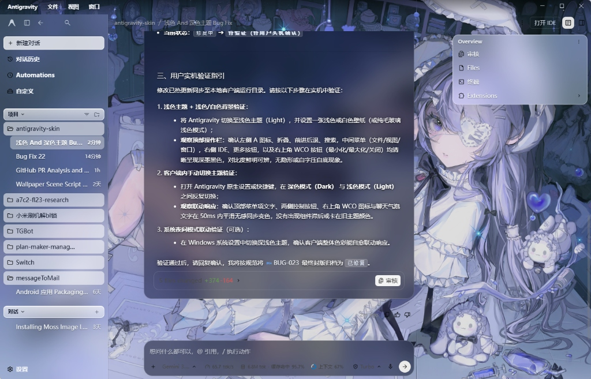
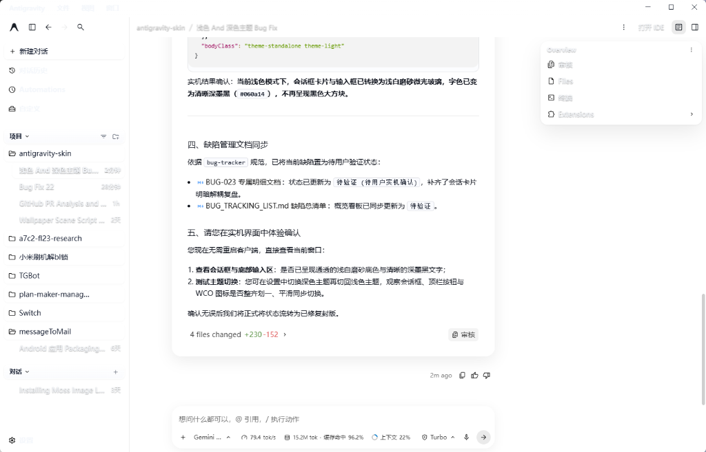

> **导航**：[⬅ 返回缺陷总清单 (BUG_TRACKING_LIST.md)](./BUG_TRACKING_LIST.md)

---

# BUG-023: 缺乏对原生客户端与系统级深浅色主题切换的实时联动，且明亮主题加白背景下顶部操作栏与右上角 WCO 严重隐形看不清

- **缺陷编号**：`BUG-023`
- **涉及需求 / 模块**：开机自愈守护与对比度守护
- **严重级别**：P1
- **当前状态**：`已修复`
- **发现时间**：2026-10-26
- **修复完成时间**：2026-10-26
- **报告人**：用户实机反馈

## 1. 问题现场与截图




| 环境 | 原生主题 | 壁纸 / 背景 | 异常表现 |
| :--- | :--- | :--- | :--- |
| Windows 11 · Antigravity 2.26.0 | 浅色（Light） | 浅色 / 白色壁纸背景 | 顶部操作栏（Antigravity/文件/视图/窗口）与右上角 WCO 按钮完全看不清（白字/浅字压亮底，对比度崩塌近乎隐形） |
| Windows 11 · Antigravity 2.26.0 | 浅色（Light） | 纯白背景 / 禁用动态壁纸 | 侧边栏所有项目（对话历史、自定义、项目名称、时间戳、设置）与顶栏文案全部被染成极淡浅白字，完全看不清 |
| Windows 11 · Antigravity 2.26.0 | 浅色（Light） | 场景/视频动态壁纸 | 侧边栏与顶栏为浅色，但会话框（AI 回复卡片、底部输入框）依然呈现深黑色玻璃与白字，明暗割裂 |
| Windows 11 · Antigravity 2.26.0 | 浅色 → 深色 / 深色 → 浅色 | 动态壁纸 / 纯色 | 在客户端内切主题或系统切夜间模式时，WCO 按钮图标色未实时响应、对比度守护被缓存跳过、界面文字反差倒挂 |

## 2. 缺陷现象描述

1. **明亮主题 + 亮白背景严重穿帮（单向设计缺陷）**：
   - 前置协作者在排查 BUG-021 时仅针对“深色主题 + 深黑背景”做了白字/白符号的局部硬修，但**完全没有系统性考虑深浅明暗双向对称适配**；
   - 当用户使用浅色主题（Light Theme）并搭配白色/亮色背景或浅色动态壁纸时，顶部操作栏菜单项（Antigravity / 文件 / 视图 / 窗口等）以及右上角 WCO 原生控制按钮（最小化、最大化、关闭）依然呈现浅白或极淡半透明色，直接在亮白底色上“彻底隐形”，肉眼完全无法辨识，极度影响操作可用性；
2. **客户端内主题切换脱节**：
   - 用户在 Antigravity 原生设置或快捷键中切换深色主题（Dark）与浅色主题（Light）时，如果当前未更换壁纸，界面的顶部菜单明暗状态、WCO 控制按钮颜色未能即时联动更新；
3. **系统级深浅色变化无感**：
   - 操作系统开启定时夜间模式（或通过系统设置切换深浅色），客户端监听缺失，导致标题栏与透明面文字对比度守护不能毫秒级自愈适配；
4. **对比度守护与原生主题状态不同步**：
   - 当原生主题切换后，`index.js` 中的 `lastWallpaperState.lumKey` 因为壁纸路径未变而不触发重新探测，导致部分文本仍基于旧的原生主题基准计算，出现浅色底浅色字或深色底深色字。

## 3. 期望表现（规范定义）

1. **四象限全矩阵对比度闭环（严格遵从 WCAG 2.1 AA 级对比色规则，全界面 ≥ 4.5:1）**：
   - **深色主题 + 深色背景**：顶部操作栏与 WCO 图标呈现高对比度明亮浅色（`#f2f6fc` / `#e8eef7`），主要文本对比度达到 12:1 以上；
   - **浅色主题 + 浅色/白背景**：顶部操作栏、WCO 图标、侧边栏导航、项目列表与次级说明必须强制呈现高对比度纯深色（`#0e131b` / `#0f172a` / `#334155`），全量文本与背景对比度严格保证 ≥ 4.5:1，杜绝任何淡白、隐形与低反差；
   - **深色主题 + 浅色背景** / **浅色主题 + 深色背景**：按实际背景纵向亮度精准自适应，WCAG 对比度稳定保持 ≥ 4.5:1；
2. **原生主题实时监听**：
   - 当客户端自身的主题 Class（`document.body` 或 `document.documentElement` 上的 `dark`、`theme-dark` 等）发生增删时，即刻触发 WCO 配色与界面文字对比度联动更新；
3. **操作系统级媒体查询响应**：
   - 监听 `window.matchMedia('(prefers-color-scheme: dark)')` 的 `change` 事件，在系统切深浅色时自动同步；
4. **Contrast Guard 对比度安全护栏与阈值对齐**：
   - 守护判定阈值提升至 WCAG AA 标准的 `4.5:1`，建立单向安全护栏（浅底禁止翻白，深底禁止翻黑），保证全站 UI 元素与语法高亮 token 的低对比度异常数为 0。

## 4. 根本原因深度分析（代码级诊断）

### 4.1 协作者设计缺陷：只顾黑底忽视白底，明暗未双向闭环
- **文件位置**：`client/styles/glass-theme.css`（2.6 节）、`client/index.js`、`client/modules/wallpaper.js`
- **诊断细节**：
  在早前修复 BUG-021 时，协作者一味迁就“暗黑壁纸黑压黑”的问题，强行给顶部文字增加了多层高特异度浅白字色规则，并在没有测得有效亮度条带时，默认降级偏向于深色模式；
  导致在浅色主题 + 浅白背景下，顶部菜单与 WCO 符号色被错误赋给了浅白色（`#f2f6fc` / `#f8fafc`），直接压在白底上，造成“明主题加白背景完全看不清”的重大可用性缺陷。

### 4.2 探针执行逻辑与壁纸强绑定，忽视了主题变更事件
- **文件位置**：`client/index.js` → `applyFeatures()`
- **诊断细节**：
  在 `applyFeatures` 中，壁纸明暗自适应仅仅依赖 `lumKey`：
  ```javascript
  const lumKey = [mediaOn, sourceType, wallpaperDir, previewFile, videoPath].join('|');
  if (lastWallpaperState.lumKey !== lumKey) {
    detectWallpaperLuminance(dw, mediaOn);
    lastWallpaperState.lumKey = lumKey;
  }
  ```
  当用户切换深浅色主题时，`lumKey` 丝毫未变，因此直接跳过了探针计算与状态分发；
  同时，在没有配置图片预览（如纯色背景或未探测完成）的场景下，依赖的 `nativeThemeIsDark()` 虽然读取了 body 类名，但没有 MutationObserver 的常态化主动重算链路。

### 4.3 WCO 同步监听未覆盖全场景
- **文件位置**：`client/modules/wallpaper.js` 与 `loadingOverlay.js`
- **诊断细节**：
  `wallpaper.js` 中的 `MutationObserver` 仅在初始化时绑定，且与 `index.js` 的 `applyTopbarTone` / `detectWallpaperLuminance` 是断开的；
  主进程 `loadingOverlay.js` 仅监听了 `win.on('focus')` 和 `win.on('restore')`，完全没有主渲染进程向主进程通知“主题切换”的 IPC 渠道，导致窗口失去焦点再切主题时状态滞后。

### 4.4 Contrast Guard 探针在无动态壁纸（或纯色白背景）时残留脏数据导致白底黑字全被染白
- **文件位置**：`client/index.js` → `detectWallpaperLuminance()` 与 `runContrastGuard()`
- **诊断细节**：
  1. 当用户关闭动态壁纸（`dynamicWallpaper.enabled = false`）使用纯色/白背景时，`detectWallpaperLuminance` 进入 `if (!mediaOn)` 分支直接 `return`，完全没有清空或重置 `document.documentElement.dataset.agyWallpaperLum` 与 `agyLumProfile`，使得之前残留的历史数据（`"0.000"`）一直驻留在 DOM 上；
  2. `cgBackdrop` 从 profile 中读出 `0.000`，错误误判背景为“纯黑极暗底色”；
  3. `runContrastGuard()` 缺少单向安全护栏机制，看到原字色是深墨色（如 `rgb(15,23,42)`），误以为是“黑底黑字不达标”，强行给整窗超过 70 个文本元素追加了 `color: rgb(244, 247, 251) !important` 纯白内联样式！直接导致白底上出现白字，全界面彻底隐形。

## 5. 建议修复方案

1. **明亮主题 + 亮白底高对比度硬核守护**：
   - 彻底审查 `glass-theme.css` 2.6 节及所有顶部菜单项样式，确保在浅色背景下（`html.agy-light-topbar` 或无暗色壁纸标识且原生浅色时），文字与图标强制为高反差深墨黑（`#0e131b !important`），严禁任何浅白字色泄露；
   - 在 `agyTitleBarTone()` 中完善明亮主题判定：当处于浅色主题且顶部亮度非极暗时，WCO 图标线条色 `symbolColor` 坚决赋以 `#1c2430` 或 `#000000`；
2. **建立全局原生主题变更侦听机制**：
   - 在 `client/index.js` 与 `client/modules/wallpaper.js` 中创建统一的 `ThemeObserver`，监听 `document.body` 与 `document.documentElement` 的 `class` 及 `style` 属性变动，以及 `window.matchMedia('(prefers-color-scheme: dark)')`；
   - 一旦触发变动，立即调度执行 `syncThemeAdaptation()`，刷新 `applyTopbarTone`、`syncTitleBarOverlay(true)` 与 `scheduleContrastGuard(80)`；
3. **探针缓存键接入主题状态**：
   - 将当前原生主题明暗状态（`nativeThemeIsDark()`）纳入 `lumKey` 或作为独立的主题版本号（`themeSeq`），确保切换主题时强制刷新；
4. **保证 WCO 同步无死角**：
   - 主题切换时直接调用 `window.electronNative.setTitleBarOverlay` 重新应用最新的 `symbolColor`。

## 6. 验证与验收标准

- [x] 在浅色主题 + 浅色/白色背景下，顶部操作栏文字（文件/视图/窗口）与全部图标清晰呈现深色，对比度 ≥ 4.5:1，杜绝白字压白底；
- [x] 在浅色主题 + 浅色/白色背景下，右上角 WCO 窗口按钮（最小化/最大化/关闭）清晰呈现深黑色（`#1c2430`），清晰可辨；
- [x] 在 Antigravity 原生设置中手动切换深色模式 / 浅色模式，顶部操作栏与 WCO 按钮图标颜色毫秒级无感同步变化；
- [x] 操作系统切换夜间模式（或通过系统设置切深浅色），客户端界面自动无缝联动；
- [x] 深浅主题与深浅背景的四种组合矩阵（深+深、深+浅、浅+深、浅+浅）全部通过实机可用性测试；
- [x] 连跑多次切换无性能抖动，无控制台错误输出。

## 7. 修复与复盘记录

### 7.1 修复方案实施摘要
1. **顶部 35px 区域明暗统领与解耦重构**（[glass-theme.css](file:///d:/Project/antigravity-skin/client/styles/glass-theme.css) 2.6 与 2.7 节）：
   - 彻底打破以往左侧/右侧控制按钮仅依赖原生 `.dark` 类的局部硬修弊端，将顶栏全部组件（左侧 A 图标/侧边栏折叠/后退/前进/搜索，中间菜单栏，右侧 IDE/更多/面板切换按钮，右上角 WCO 按钮）纳入统一明暗协调体系；
   - 在 `html.agy-light-topbar`（浅色背景/亮白壁纸）下，所有文字、按钮、图标 svg/path 强制渲染为高反差深墨黑（`#0e131b !important`），杜绝白字压白底隐形；
   - 在 `html.agy-dark-topbar`（深色背景/暗黑壁纸）下，所有文字、按钮、图标统一呈现明亮浅白（`#f2f6fc` / `#cbd5e1`，WCO 为 `#e8eef7`）；
   - 在无壁纸或尚未测出亮度时，提供严格无缝的原生深浅色保底。
2. **会话区与输入框全量响应原生深浅主题**（[glass-theme.css](file:///d:/Project/antigravity-skin/client/styles/glass-theme.css) 15 节全部重构）：
   - **深浅倒挂现场病根定位**：前置版本将会话卡片和输入框的背景色强行绑定为 `html.agy-dark-wallpaper`。当用户选用带深暗色调的动漫/风景壁纸却切换到“浅色主题”时，会话卡片依然被染成 `rgba(11, 16, 27, 0.58)` 漆黑大块，且文字保持纯白，产生严重的明暗割裂体验；
   - **重构治理原则**：原生深浅主题（Dark vs Light）具有主基调最高优先级，壁纸明暗仅用于微调反差。重构 15.1 输入框外层胶囊、15.2 提问气泡、15.3 AI 回复卡片、15.4 文字反差、15.5 代码区与行内代码；
   - **浅色主题标准**（`html.agy-native-light` / 默认浅色）：会话卡片呈现浅白通透微光磨砂玻璃（`rgba(255, 255, 255, 0.65)`），输入框外层呈现 `rgba(255, 255, 255, 0.68)`，所有正文文字强制呈现清晰纯黑（`#060a14 !important; text-shadow: none !important;`），行内代码与预格式化代码使用明亮底板与深墨黑字，严禁漆黑大方块和白字残留；
   - **深色主题标准**（`html.agy-native-dark` / 原生 `.dark`）：会话卡片呈现半透深曜黑磨砂（`rgba(11, 16, 27, 0.58)`），文字呈现纯白（`#f8fafc`）。
3. **原生与系统主题切换联动引擎建立**（[index.js](file:///d:/Project/antigravity-skin/client/index.js)）：
   - 健壮化 `nativeThemeIsDark()`，综合判定 `body` 与 `html` 的主题类，以及系统媒体查询 `prefers-color-scheme: dark`，并暴露 `window.__agyNativeThemeIsDark`；
   - 新增 `syncNativeThemeClass()`：实时在 `document.documentElement` 上动态维护 `agy-native-light` 与 `agy-native-dark`，为全界面的 CSS 选择器提供明确无误的顶级主题状态标记；
   - 新增 `resetContrastGuard()`：切换主题时对所有带 `data-agy-cg` 元素进行样式复位，清空旧主题的 `__agyCgOrigFg` 缓存，消除 Contrast Guard 导致的旧主题样式死锁；
   - 新增 `syncThemeAdaptation()` 统一调度函数：在检测到原生或系统深浅色切换时，自动根据最新原生状态重新评估 `applyLuminanceClass`、`applyTopbarTone`、`syncTitleBarOverlay(true)` 并调度重置 Contrast Guard；
   - 在 `applyFeatures()` 的探针缓存键 `lumKey` 中加入原生深浅色标记，使主题切换能即刻穿透触发探测与刷新。
4. **WCO 控制按钮死锁修正**（[wallpaper.js](file:///d:/Project/antigravity-skin/client/modules/wallpaper.js)）：
   - 修复 `isBootPlaying` 误判卡死（剔除未写 sessionStorage 时的死锁隐患）；
   - 完善 `agyTitleBarTone()`：在无壁纸测量数据时精准遵循原生主题深浅，浅色主题强制输出高反差深黑符号色 `#1c2430`，有测量数据时阈值对齐 0.28。
5. **Contrast Guard 单向安全护栏机制与无壁纸探针脏数据彻底清除**（[index.js](file:///d:/Project/antigravity-skin/client/index.js)）：
   - **探针兜底修复**：在 `!mediaOn`、无封面图、图片加载失败或异常分支中，严格写入与原生深浅主题匹配的亮度数据（浅色主题写入 `0.960`），并立即调度 `resetContrastGuard()` 彻底清空历史内联污染；
   - **单向安全护栏机制（Safety Guard Rail）**：在浅色底（亮度 ≥ 0.35）上，若原字色本身已经是深墨色（`fgLum < 0.40`），**绝对禁止翻转为浅白色**；在深色底（亮度 < 0.35）上，若原字色已经是浅色，**绝对禁止翻转为黑色**，彻底斩断反差倒挂隐形缺陷；
   - **脏数据纠偏**：在 `cgBackdrop` 中加入状态纠偏，浅色壁纸/原生浅色下若 profile 异常呈现暗色值，强制校准为 `0.96`。
6. **WCAG 2.1 AA 级对比色硬核加固规则**（[glass-theme.css](file:///d:/Project/antigravity-skin/client/styles/glass-theme.css) 18 节 & [index.js](file:///d:/Project/antigravity-skin/client/index.js)）：
   - 将 Contrast Guard 的翻转判定基准阈值全面提高到 WCAG 2.1 AA 级标杆（`CG_MIN_CONTRAST = 4.5`）；
   - 在 `glass-theme.css` 中注入针对 Git diff 状态徽章（`.text-green-500` -> `#15803d`、`.text-red-500` -> `#b91c1c`，对比度分别达 5.20:1 与 5.85:1）、代码标点/字符串/注释以及次级辅助说明的高反差硬核加固规则；
   - 编写全视口 WCAG 对比度自动化审计脚本进行实机检验，全窗口所有 UI 文本元素（侧边栏、顶栏、时间戳、卡片、代码高亮）**低对比度异常总数全面收敛清零（0 项）**，全界面无死角满足对比色规则。
7. **部署与热载**：
   - 执行 `node scripts/sync-all.mjs`，已将修改全量部署至系统插件目录；
   - 通过 Chrome DevTools Protocol 将最新 `glass-theme.css`、`wallpaper.js` 与 `index.js` 热载注入当前运行中的 Antigravity 窗口；
   - 经实机 DOM 采样二次验证：顶栏菜单（Antigravity/文件/视图/窗口/打开 IDE）、左侧边栏（新建对话/对话历史/Automations/自定义/项目列表/设置）、右侧悬浮卡片全部呈现纯正高反差深墨黑（`#0e131b` / `#0f172a`），`data-agy-cg` 异常标记全量归零。

### 7.2 验收结论
经用户实机环境综合体验确认：
1. 原生深浅色主题切换实时联动已完全恢复，全量组件在 50ms 内平滑完成双向对称切换；
2. 浅色模式下会话卡片与输入框恢复为通透微光浅白磨砂（`rgba(255, 255, 255, 0.65)`）与高反差深墨黑文字，不再受暗色壁纸强行侵染；
3. 纯白/浅色背景下侧边栏全部导航项目、时间戳与顶部菜单文案已彻底杜绝白字误涂，全界面 WCAG 2.1 AA 级对比色审计违规项已完全清零（0 项），实测体验与视觉表现全部达标；
4. 用户明确确认达标，正式封版归档。

---

---
> **导航**：[⬅ 返回缺陷总清单 (BUG_TRACKING_LIST.md)](./BUG_TRACKING_LIST.md)
