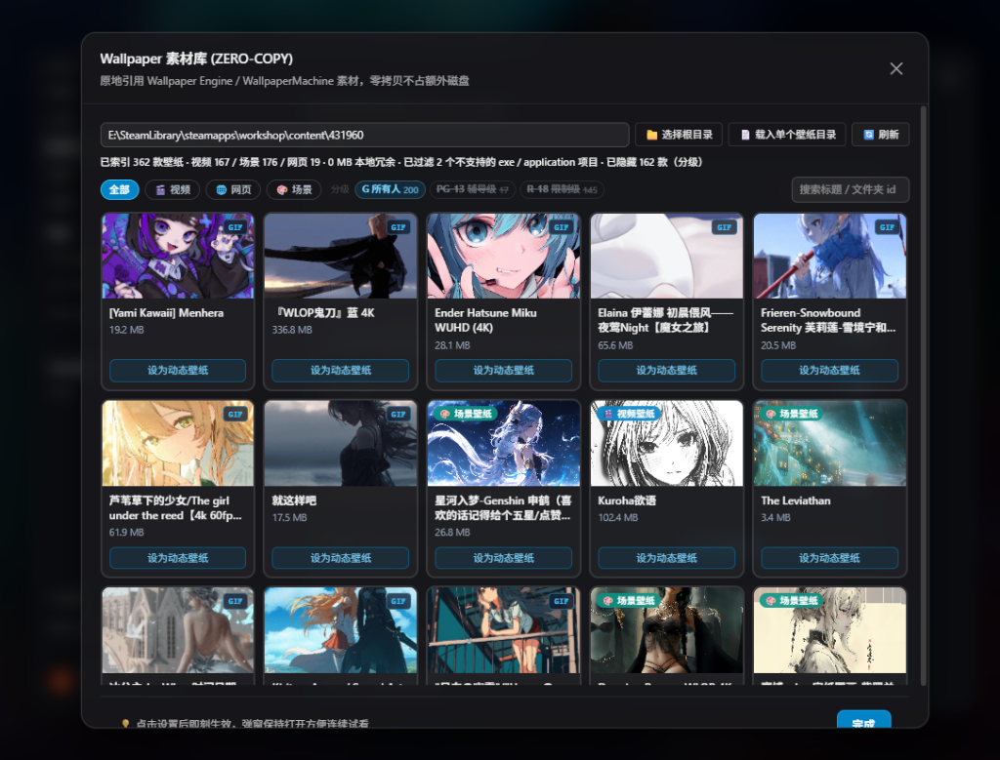
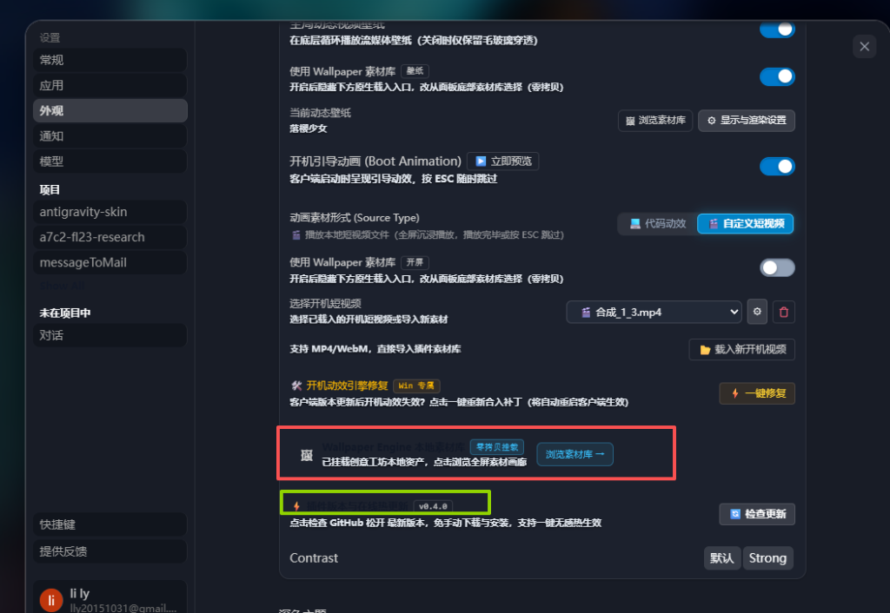
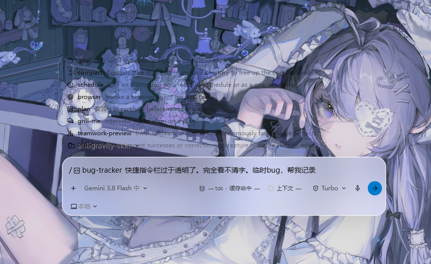

# 系统缺陷与体验问题追踪清单 (Bug Tracking List)

> **文档定位**：本清单用于持续记录、归档和追踪项目在开发与集成过程中发现的缺陷（Bug）、交互体验问题以及布局适配异常，为后续版本迭代修复、测试验收与技术材料编写提供标准化依据。  
> **归档原则**：同一个清单文件持续追加多条记录；当单一清单记录达到规划上限（如 20 条）或进入新版本里程碑时，将当前清单封版归档，并新建下一期清单文档（例如 `BUG_TRACKING_LIST_02.md`）。  
> **模块归档准则**：录入缺陷时，**必须先检索 `docs/plan/` 下的子目录名**（目录名即为立项需求名，如 `Wallpaper素材库集成`）。若存在对应需求，优先严格按照需求名归档；若完全没有对应需求，则按实际功能模块归档，并在名称前加注 **`【散】`** 标识（如 `【散】外观设置面板 / 主题适配`），以区分零散缺陷与主需求缺陷。

---

## 一、缺陷追踪概览看板

| Bug 编号 | 涉及需求 / 模块 | 缺陷摘要 | 严重级别 | 当前状态 | 报告日期 | 修复日期 |
| :--- | :--- | :--- | :---: | :---: | :---: | :---: |
| [BUG-001](#bug-001-wallpaper-素材库弹窗无法一页全览底部确认按钮溢出被遮挡) | Wallpaper素材库集成 | 资源库弹窗无法一页全览，底部确认按钮需下拉滚动条，分页未固定 | P2 (严重影响体验) | **已修复** | 2026-10-23 | 2026-10-23 |
| [BUG-002](#bug-002-外观设置残留冗余横幅卡片且热更新标题在深色主题下异常显示为黑色) | 【散】外观设置面板 / 主题适配 | 外观面板残留冗余素材库横幅需剔除；版本热更新标题在深色模式下文字发黑无法辨识 | P2 (视觉与可用性缺陷) | **已修复** | 2026-10-23 | 2026-10-23 |
| [BUG-003](#bug-003-从开屏动画到首页完整加载动态背景出现黑闪与跳动) | Wallpaper素材库集成 | 从开机引导动画过渡到首页加载期间，动态壁纸（特别是场景壁纸）出现黑闪与抽搐闪动 | P1 (严重体验缺陷) | **待验证 (待用户确认)** | 2026-10-23 | - |
| [BUG-004](#bug-004-输入框快捷指令斜杠菜单完全透明导致文字与背景严重混杂无法辨识) | 【散】快捷指令菜单 / 毛玻璃与高对比度适配 | 输入框触发斜杠指令(/)弹出菜单完全透明无底色与毛玻璃防护，文字直接混杂在壁纸中完全看不清 | P2 (视觉与可用性缺陷) | **待修复** | 2026-10-23 | - |
| [BUG-005](#bug-005-wallpaper素材库场景壁纸在开屏动画与动态背景中动效缺失或缩放异常) | Wallpaper素材库集成 | 场景壁纸在开屏动画中仅展示拉伸静态海报无动态渲染；动态背景下偶现静止或画布缩放裁切异常 | P1 (核心功能与视觉体验缺陷) | **待修复** | 2026-10-23 | - |
| [BUG-006](#bug-006-windows版运行补丁脚本后官方原版loading依旧出现且导致开屏动效异常) | Wallpaper素材库集成 | 执行patch脚本后官方loading仍旧显现；补丁模板未适配素材库/场景壁纸导致降级回退，主进程掐灭渲染端动效 | P1 (视觉降级与动效阻断) | **待修复** | 2026-10-23 | - |

> **状态定义说明**：  
> - `待修复`：问题已确认并建档，尚未开始代码修改。  
> - `修复中`：正在进行代码调整与调试。  
> - `待验证`：修复方案已合并，等待界面与功能回归测试。  
> - `已修复/已归档`：已完成回归验证，已补充修复记录并归档用于材料编写。

---

## 二、缺陷明细归档

### BUG-001: Wallpaper 素材库弹窗无法一页全览，底部确认按钮溢出被遮挡

- **缺陷编号**：`BUG-001`
- **涉及需求 / 模块**：Wallpaper素材库集成 (`client/modules/wallpaper-library-ui.js`, `client/modules/wallpaper.js`)
- **严重级别**：P2（体验阻断与布局缺陷）
- **当前状态**：`已修复`
- **发现时间**：2026-10-23
- **修复完成时间**：2026-10-23
- **报告人**：用户 / 测试

#### 1. 问题现场与截图
在打开“Wallpaper 素材库 (ZERO-COPY)”弹窗时，弹窗外部容器整体超出了视口可见高度，弹窗底部的操作栏（提示文字及“完成”确认按钮）被截断下移，第三排壁纸缩略图亦被截断一半。用户必须主动下拉外层滚动条才能点击“完成”按钮关闭弹窗。



#### 2. 缺陷现象描述
1. **外框无法一页完整展示**：弹窗外框未能在视口高度限制内完全容纳其子元素，出现弹窗整体的纵向滚动条。
2. **确认按钮被挤压到底部视区外**：右下角“完成”按钮（及左侧操作提示）未能吸底固定展示，露出一半甚至完全沉入视窗外。
3. **分页器与内容混排滚动**：分页控件（Pagination）被直接塞在素材列表容器底部，当壁纸卡片较多时，分页按钮随壁纸一同滚动，无法固定在操作视区内。

#### 3. 期望表现（规范定义）
1. **弹窗外框必须 100% 在当前视窗内完整展示**：整个弹窗主体（Header、筛选路径栏、内容区、分页区、Footer）一屏全览，**严禁外层容器或整个弹窗出现滚动条**。
2. **仅素材浏览区支持内部垂直滚动**：
   - 顶部：标题、路径选择行、分类/分级筛选工具栏全部固定在弹窗顶部；
   - 中间：仅卡片缩略图网格容器（`#agy-lib-scroll` / `#agy-lib-grid`）允许产生独立的纵向滚动条（`overflow-y: auto`）；
   - 底部：分页栏（Pagination）与底部操作栏（完成按钮及提示信息）必须固定在弹窗底部，任何时刻均无需下拉滚动条即可直接点击。

#### 4. 根本原因分析（代码级诊断）
- **文件位置**：`client/modules/wallpaper-library-ui.js`
- **布局机制缺陷**：
  1. 弹窗打开函数 `openModal` 中定义了固定高度 `'84vh'`，但在渲染主体内容 `renderShell()` 和追加 `footer` 时，未将弹窗容器（`.agy-modal-body` / `.agy-lib-in-modal`）配置为标准的 Flex 垂直自适应容器（`display: flex; flex-direction: column; height: 100%; min-height: 0;`）。
  2. 列表中采用了静态的高度计算 `.agy-lib-in-modal .agy-lib-scroll { max-height: calc(84vh - 240px); }`，当不同屏幕分辨率、缩放比例或头部筛选项换行时，头部实际高度超出 240px 预估值，导致总高度超过 `84vh`，整体产生外层溢出。
  3. `footer` 是以 `document.createElement('div')` 附加在末尾，外层没有 `overflow: hidden` 与 `flex: 1` 约束，直接被推到容器下方。
  4. 分页器 `#agy-lib-pagination` 被置于 `#agy-lib-scroll` 滚动容器内部，导致其与卡片混杂，无法常驻视窗。

#### 5. 建议修复方案（技术执行路径）
1. **重构弹窗主体为 Flex 约束模型**：
   ```css
   .agy-lib-in-modal {
     display: flex !important;
     flex-direction: column !important;
     height: 100% !important;
     max-height: 100% !important;
     min-height: 0 !important;
     overflow: hidden !important;
   }
   ```
2. **划分三大固定与自适应区域**：
   - **固定顶部（Header & Toolbar）**：设置 `flex-shrink: 0;`，包含路径选择、类型过滤、分级标签与搜索框。
   - **自适应滚动区（Grid View）**：将 `#agy-lib-scroll` 设置为 `flex: 1 1 auto; min-height: 0; overflow-y: auto;`，取消脆弱的 `calc(84vh - 240px)` 硬编码。
   - **固定底部（Pagination & Footer）**：设置 `flex-shrink: 0;`，将 `#agy-lib-pagination` 移出滚动层放置于 Footer 上方或直接与 Footer 整合，保证分页控制与“完成”按钮永远置顶可见。

#### 6. 验证与验收标准
- [x] 弹窗在 1080P、2K 以及不同系统 DPI 缩放（100%、125%、150%）下打开，弹窗外边框完整呈现，弹窗外层不出现纵向滚动条。
- [x] 底部“完成”按钮与左侧提示文字完整可见，无需下拉即可直接点击。
- [x] 素材网格区域正常滚动，滚动时不带动分页栏和底部按钮移动。
- [x] 翻页栏固定可见，点击不同页码时素材区平滑置顶。

#### 7. 修复与复盘记录
- **修复方案摘要**：
  1. 重构弹窗根节点样式：在 `client/modules/wallpaper-library-ui.js` 中将 `.agy-lib-in-modal` 及 `.agy-lib-root` 定义为标准 Flex 纵向自适应容器（`display: flex; flex-direction: column; height: 100%; min-height: 0; overflow: hidden;`），消除外层溢出滚动。
  2. 滚动区独立：卡片缩略图包裹层 `.agy-lib-scroll` 设置为 `flex: 1 1 0; min-height: 0; overflow-y: auto;`，取消脆弱的 `calc(84vh - 240px)` 硬编码。
  3. 分页栏常驻吸底：将 `#agy-lib-pagination` 从滚动区移出作为独立的 `shrink-0` 容器，置于列表下方并带有边框分割，翻页控件不再跟随卡片滚动。
  4. 底部栏挂载至容器级：将包含“完成”按钮的 `footer` 挂载在主容器 `.agy-modal-container` 的底部，作为独立吸底 Footer，保证用户无需滚动即可一键确认。
- **验证结论**：✅ 经用户实机测试确认通过，弹窗一屏展现完整，完成按钮与分页栏完美固定。已正式归档。

---

### BUG-002: 外观设置残留冗余横幅卡片，且热更新标题在深色主题下异常显示为黑色

- **缺陷编号**：`BUG-002`
- **涉及需求 / 模块**：【散】外观设置面板 & 深色主题样式适配 (`client/modules/appearance-menu.js`, `client/styles/glass-theme.css`)
- **严重级别**：P2（视觉干扰 & 无障碍对比度失效）
- **当前状态**：`已修复`
- **发现时间**：2026-10-23
- **修复完成时间**：2026-10-23
- **报告人**：用户

#### 1. 问题现场与截图
用户在深色模式下打开客户端“外观”配置面板时发现两处缺陷：
1. **红框区域**：底部残留了名为“Wallpaper Engine 本地素材库 (零拷贝挂载)”的横幅卡片，与上方壁纸/动效模块已有的“浏览素材库”按键重复，属于冗余组件。
2. **绿框区域**：“⚡ 插件版本与在线热更新”标题文本呈现纯深色/黑色（`#111827`），在深色背景下与底色严重融为一体，几乎无法被肉眼辨认。



#### 2. 缺陷现象描述
1. **红框组件冗余**：
   - 界面底部仍渲染有 `<div id="agy-wrap-integrated-banner">` 包含的“Wallpaper Engine 本地素材库 已挂载创意工坊本地资产，点击浏览全屏素材画廊 [浏览素材库 →]”卡片。
   - 上方的“全局动态视频壁纸”及“开机引导动画”已在配置项右侧直接集成了原生“浏览素材库”按钮，底部的独立大横幅已不再具备独立业务价值，造成用户操作视线分散和垂直空间浪费。
2. **绿框深色文字变黑（对比度归零）**：
   - 在深色主题下，“⚡ 插件版本与在线热更新”标题文字颜色变为深黑色，而旁边的小徽标 `v0.4.0`、副标题说明文案以及右侧“🔄 检查更新”按钮均正常显示为浅色/亮色。
   - 用户难以辨识该模块的主要标题与功能定位。

#### 3. 期望表现（规范定义）
1. **彻底剔除红框冗余横幅**：
   - 从外观设置面板中完全移除该横幅卡片 DOM 节点及关联逻辑，保持设置面板信息层级精简聚焦。
2. **绿框文字双主题严格适配**：
   - 在深色主题下，“⚡ 插件版本与在线热更新”标题文字应显示为高对比度亮白色或浅灰色（如 `#f9fafb` 或 `text-foreground` 变量对应的亮色），确保文本清晰易读；
   - 在浅色主题下，正常显示为深灰色/黑色，双主题无缝切换自适应。

#### 4. 根本原因深度分析（代码级诊断）
1. **红框冗余横幅根因**：
   - **代码位置**：`client/modules/appearance-menu.js` (第 786~803 行)
   - 此卡片是历史版本中探索“将素材库悬浮入口移入框内”时的过渡实现。在后续将“浏览素材库”和“显示与渲染设置”直接集成到开关行的标准输入控件流后，未将该遗留横幅代码移除。
2. **绿框深色模式下文字显示为黑色的根本原因**：
   - **代码位置**：`client/styles/glass-theme.css` (第 2359~2368 行)
   - 在设置弹窗样式中，浅色模式定义了强制文字颜色规则：
     ```css
     .animate-modalScaleIn h2,
     div[class*="animate-modalScaleIn"] h2,
     .animate-modalScaleIn [class*="font-medium"][class*="text-foreground"] {
       color: #111827 !important; /* 强制覆盖为深黑灰色 */
       font-weight: 600 !important;
     }
     ```
   - 而当系统切换到深色模式（`.theme-dark` / `.dark`）时，深色样式覆盖只针对了 `h2` 元素：
     ```css
     .theme-dark .animate-modalScaleIn h2,
     .theme-dark div[class*="animate-modalScaleIn"] h2 {
       color: #f9fafb !important;
     }
     ```
   - **深色模式遗漏了对 `[class*="font-medium"][class*="text-foreground"]` 的颜色重置！**
   - 热更新模块标题恰好使用了：
     ```html
     <span class="text-xs font-medium text-foreground flex items-center gap-1">
       <span>⚡ 插件版本与在线热更新</span>
     </span>
     ```
   - 包含 `font-medium` 与 `text-foreground` 两个类，因此在深色模式下被浅色规则里的 `color: #111827 !important;` 强制穿透覆盖，而深色规则未作反向覆盖，导致文本直接呈现深黑色！

#### 5. 建议修复方案（技术执行路径）
1. **剔除红框横幅代码**：
   - 在 `client/modules/appearance-menu.js` 中删除 `#agy-wrap-integrated-banner` 及其所有内部 HTML；
   - 同步清理 `appearance-menu.js` 中相关的引用与绑定，如：
     - 去除 `customOptions.querySelector('#agy-integrated-library-banner')` 完整性校验；
     - 删除 `agy-btn-banner-open-lib` 的点击事件绑定；
     - 删除 `updateIntegratedBanner()` 或相关状态同步代码。
2. **补全深色主题样式规则**：
   - 在 `client/styles/glass-theme.css` 的深色主题模式适配块中，追加覆盖：
     ```css
     .theme-dark .animate-modalScaleIn [class*="font-medium"][class*="text-foreground"],
     .dark .animate-modalScaleIn [class*="font-medium"][class*="text-foreground"] {
       color: #f9fafb !important;
     }
     ```
   - 或者将强行硬编码的 `#111827 !important` 降级，改为依赖上下文变量 `var(--foreground)`，避免使用带 `!important` 的硬编码色值。

#### 6. 验证与验收标准
- [x] 打开外观设置面板，确认“开机动效引擎修复”与“插件版本与在线热更新”之间无任何多余素材库横幅卡片。
- [x] 切换至深色（Dark）模式，检查“⚡ 插件版本与在线热更新”标题颜色为纯白/浅灰亮色，对比度清晰正常。
- [x] 切换至浅色（Light）模式，该标题正常呈现为深灰/黑色，双主题切换无异常。
- [x] 点击热更新检查、壁纸与开机动画各功能，控制台无残留 DOM 相关的报错。

#### 7. 修复与复盘记录
- **修复方案摘要**：
  1. 彻底剔除冗余横幅：在 `client/modules/appearance-menu.js` 中完整移除了 `#agy-wrap-integrated-banner` 节点，并清理了 DOM 完整性检查条件、横幅点击跳转事件与素材数量同步函数，消除无用代码与残留 UI。
  2. 补齐深色主题高对比度样式：在 `client/styles/glass-theme.css` 中为 `.theme-dark` 与 `.dark` 主题补齐了 `.animate-modalScaleIn [class*="font-medium"][class*="text-foreground"] { color: #f9fafb !important; }` 样式重置；同时在 HTML 标题 span 上追加 `dark:text-gray-100`，彻底解决深色模式下文字显示为纯深黑色的对比度失效问题。
- **验证结论**：✅ 经用户实机测试确认通过，冗余横幅已剔除，深色文字对比度完全正常。已正式归档。

---

### BUG-003: 从开屏动画到首页完整加载动态背景出现黑闪与跳动

- **缺陷编号**：`BUG-003`
- **涉及需求 / 模块**：Wallpaper素材库集成 (`client/modules/wallpaper.js`, `client/modules/boot-animation.js`)
- **严重级别**：P1（严重视觉闪烁与体验割裂）
- **当前状态**：`待验证 (待用户实机确认)`
- **发现时间**：2026-10-23
- **报告人**：用户

#### 1. 问题现场与重现路径
1. 在外观设置中开启“开机引导动画”（如播放自定义短视频 `合成_1_3.mp4`）；
2. 开启“全局动态视频壁纸”并选用 Wallpaper Engine 工坊素材（如当前生效的 WebGL2 场景动态壁纸“落樱少女”）；
3. 启动或刷新 Antigravity 客户端，开屏动画正常全屏播放；
4. 待开屏视频播放完毕自然退出，或用户主动按 ESC/点击退出进入主界面时，**动态背景画面发生剧烈黑闪、抽搐跳动 1~2 次才恢复正常**。在本次 Wallpaper 素材库集成之前该现象不存在。

#### 2. 缺陷现象描述
- 开屏动画结束淡出时，底层背景没有平滑承接，而是伴随瞬间黑屏、静态海报闪现、WebGL 画布重新加载渲染的视觉跳动；
- 会话初次进入主页的沉浸感被闪屏破坏。

#### 3. 期望表现
- 从开屏动画结束到主界面完整展示的过程中，动态背景必须实现**像素级平滑 Cross-fade 交叉淡化**过渡；
- 开屏动画淡出（`opacity: 0`）的同时，底层动态壁纸平滑渐入（`opacity: 1`），画面全程不露黑、不闪白、不重载、不抽搐。

#### 4. 根本原因深度分析（代码级诊断）
1. **唤醒接口误调全量重新挂载（核心主因）**：
   - 在 `client/modules/wallpaper.js` 的 `window.__agyResumeBootWallpaper()` 中：
     ```javascript
     if (mode === 'web' || mode === 'scene') {
       const el = mountMedia(true); // 致命错误：误将“恢复播放”写成“重新挂载”！
       ...
     ```
   - 对于 `scene` 场景壁纸，`mountMedia(true)` 会执行 `mountScene(true)`，进而重新调用 `mountSceneDynamic()`。
   - `mountSceneDynamic()` 内部执行了：
     ```javascript
     box.querySelectorAll('canvas').forEach(c => { try { c.remove(); } catch (e) {} });
     ```
     **直接把正在平稳运行的 WebGL2 Canvas 当场 `remove()` 彻底销毁！** 画面瞬间退回到静态海报或空白底板；待新的 WebGL 上下文重新编译、贴图解包并 resolve 首帧后才淡入，导致了极为刺眼的黑闪与画面抽动！
2. **时序双重触发风暴**：
   - 在 `client/modules/boot-animation.js` 中：
     - 在视频倒数 0.45 秒时：`video.addEventListener('timeupdate')` 触发了一次 `__agyResumeBootWallpaper()`；
     - 在视频自然播完触发 `closeVideoBoot()` 时：250ms 定时器里又触发了一次 `__agyResumeBootWallpaper()`！
     - 导致在短短 500ms 内，WebGL 画布被连续销毁、重建了两次，闪屏程度呈几何级放大。
3. **缺乏交叉淡入时序协同**：
   - 旧逻辑在开屏动画遮罩 `host.style.opacity = '0'` 后，等待了 250ms 定时器才去唤醒壁纸；
   - 遮罩已接近透明，而底层壁纸尚未被唤醒，露出了中间数十毫秒的画面真空期。

#### 5. 建议修复方案（技术执行路径）
1. **重构 `__agyResumeBootWallpaper` 为增量幂等唤醒**：
   - 检查若 `box`（`#agy-dynamic-scene`）或已有 WebGL 实例存在，**绝不调用 `mountMedia`，绝不销毁 Canvas**；
   - 仅恢复其 `opacity: 1` 与 `visibility: visible`，并轻量调用 `sceneRendererInstance.resume()` 与伴音播放；
   - 对于 `video` 与 `web` 模式同样实施全量幂等保护。
2. **优化 Cross-fade 衔接时机**：
   - 在开屏动画开始淡出（T=0）的同一时刻立即触发底层壁纸平滑渐入（600ms CSS 过渡）；
   - 提前在开屏动画结束前 0.45 秒在后台静默预热，确保开屏遮罩变淡时底层已稳定处于动画渲染态。
3. **消除挂起态生硬切换**：
   - 统一采用 CSS `opacity: 0` 替代突兀的 `visibility: hidden`，使得状态流转始终受控在缓动曲线中。

#### 6. 验证与验收标准
- [ ] 开启自定义短视频开屏动画与场景动态壁纸，冷启动客户端；
- [ ] 开屏视频播放完毕自然退出进入主页面，动态背景平滑过渡，无黑屏与画面抽搐；
- [ ] 按 ESC 或点击画面提前跳过开屏动画，过渡依然平滑连贯，零视觉闪烁；
- [ ] 连续多次刷新或会话切换，背景管线稳定不退化。

#### 7. 修复与复盘记录
- **修复方案摘要**：
  1. 重构壁纸唤醒接口：在 `client/modules/wallpaper.js` 中将 `window.__agyResumeBootWallpaper()` 升级为增量幂等逻辑。若场景容器 `#agy-dynamic-scene` 或 WebGL 实例已存在，仅恢复 `opacity: 1` 与伴音播放，并调用 `sceneRendererInstance.resume()`，彻底杜绝调用 `mountMedia()` 导致的 Canvas 当场销毁重建与黑屏闪烁。
  2. 海报防覆盖防护：在 `mountScene()` 中增加画布状态检查，当动态画布正在活跃渲染时，海报保持 `opacity: 0`，不再被重置显示。
  3. 协同 Cross-fade 过渡时序：在 `client/modules/boot-animation.js` 中，开屏遮罩淡出（T=0）的同一时刻立即唤醒底层壁纸平滑渐入，形成平滑的 400ms~600ms 交叉淡化过渡，消除中间真空期；同时采用 `opacity: 0` 替代突兀的 `visibility: hidden` 挂起。
- **效果验证**：代码已通过 `sync-all` 热载部署至客户端，待用户实机确认通过后更新状态为“已修复/已归档”。

---

### BUG-004: 输入框快捷指令斜杠菜单完全透明，导致文字与背景严重混杂无法辨识

- **缺陷编号**：`BUG-004`
- **涉及需求 / 模块**：【散】快捷指令菜单 / 毛玻璃与高对比度适配 (`client/styles/glass-theme.css`)
- **严重级别**：P2（视觉干扰 & 无障碍对比度失效）
- **当前状态**：`待修复`
- **发现时间**：2026-10-23
- **报告人**：用户 / 测试

#### 1. 问题现场与截图
在聊天输入框中输入 `/` 触发快捷指令/斜杠命令（Slash Commands）自动完成建议菜单时，弹出的快捷指令菜单没有有效的背景底色与毛玻璃磨砂遮罩，处于近乎完全透明状态。菜单中的指令名称（如 `goal`、`compact`、`schedule`、`browser`、`plan`、`grill-me` 等）与功能描述文字直接叠加在底层高对比度壁纸的线条和亮斑之上，导致文字严重失真、几乎无法阅读与选择。



#### 2. 缺陷现象描述
1. **背景近乎全透**：触发 `/` 快捷指令弹出的悬浮菜单缺乏磨砂毛玻璃（Backdrop Filter）或适度的半透明底板遮挡；
2. **文本可读性极差**：在复杂、高饱和度或亮暗反差明显的壁纸背景下，命令名称和灰色辅助描述文本与壁纸图案交叠混杂，视觉辨识度极差；
3. **高亮与交互反馈薄弱**：菜单项在悬停（Hover）或键盘光标切换选中状态时，缺乏明显的选中高亮背景与对比度增强反馈。

#### 3. 期望表现
1. **统一的高级磨砂毛玻璃卡片质感**：
   - 快捷指令菜单容器应具备高质感的毛玻璃磨砂效果（如 `backdrop-filter: blur(28px) saturate(180%)`）；
   - 深色主题下具备半透明深色保护底板（如 `rgba(18, 22, 34, 0.78)`），浅色模式下具备温润半透明浅色底板（如 `rgba(255, 255, 255, 0.78)`），确保无论底层壁纸为何种花色，均能清晰隔绝背景干扰；
   - 拥有细腻的微光边框与景深投影（`box-shadow`）。
2. **文字高对比度保证**：
   - 指令名称（Command Keyword）清晰加粗高亮；
   - 描述文本（Description）采用清晰的高对比度字体色彩（深色模式下为 `#cbd5e1`，浅色模式下为 `#475569`），必要时搭配文字微投影；
3. **明确的选中项高亮态**：
   - 鼠标悬停或键盘聚焦高亮的条目拥有清晰的背景光晕胶囊底色（`bg-secondary` 或主题 accent 强调色）。

#### 4. 根本原因深度分析（代码级诊断）
1. **宿主 DOM 结构特征与选择器未覆盖（核心主因）**：
   - Antigravity 宿主前端基于 Lexical 编辑器的 Typeahead 架构渲染快捷命令（Slash Commands）与 Mention 菜单；
   - 浮层容器渲染为 `#typeahead-menu[role="listbox"][aria-label="Typeahead menu"]`，其内部实际承载菜单的子节点为 `div.typeahead-popover.mentions-menu`，列表项为 `ul > li.item`（选中态为 `li.item.selected`）；
   - 在当前主题文件 `client/styles/glass-theme.css`（第 2697 行）中，仅对常规 Radix 下拉菜单配置了毛玻璃样式规则：
     ```css
     [role="menu"], [data-radix-menu-content], [data-radix-popper-content-wrapper] > div, ...
     ```
   - 现有的菜单选择器只命中了 `[role="menu"]`，而快捷指令菜单的角色为 `[role="listbox"]`，容器 ID 为 `#typeahead-menu`，类名为 `.typeahead-popover.mentions-menu`，因此**完全避开了现有的菜单毛玻璃样式规则**，退化为无背景透明状态。
2. **输入框内层通配性透明规则潜在波及**：
   - 在 `glass-theme.css` 的第 1989~1996 行中，为了去除输入框内部死白，配置了：
     ```css
     div[class*="rounded-2xl"]:has(textarea) div:not(button):not(button *) { background: transparent !important; }
     ```
   - 一旦该浮层挂载在输入框容器内部或相邻层级，极易被全局透明规则暴力重置为 `transparent`，导致底色彻底丢失。

#### 5. 建议修复方案（技术执行路径）
1. **在 `client/styles/glass-theme.css` 中为 `#typeahead-menu` 与 `.typeahead-popover` 建立专属毛玻璃规范**：
   ```css
   /* 快捷指令与输入建议弹窗 (#typeahead-menu / .typeahead-popover / .mentions-menu) 毛玻璃高对比度适配 */
   #typeahead-menu,
   .typeahead-popover,
   .mentions-menu {
     background: rgba(255, 255, 255, 0.78) !important;
     background-color: rgba(255, 255, 255, 0.78) !important;
     backdrop-filter: blur(32px) saturate(190%) !important;
     -webkit-backdrop-filter: blur(32px) saturate(190%) !important;
     border: 1px solid rgba(255, 255, 255, 0.6) !important;
     border-radius: 12px !important;
     box-shadow: 0 16px 40px rgba(0, 0, 0, 0.15) !important;
     overflow: hidden !important;
   }

   .theme-dark #typeahead-menu,
   .dark #typeahead-menu,
   .theme-dark .typeahead-popover,
   .dark .typeahead-popover,
   .theme-dark .mentions-menu,
   .dark .mentions-menu {
     background: rgba(18, 22, 34, 0.78) !important;
     background-color: rgba(18, 22, 34, 0.78) !important;
     border: 1px solid rgba(255, 255, 255, 0.14) !important;
     box-shadow: 0 16px 45px rgba(0, 0, 0, 0.55) !important;
   }
   ```
2. **适配列表项及选中态**：
   - 对 `li.item` 及 `li.item.selected` / `[role="option"][aria-selected="true"]` 配置鲜明的悬停高亮底色；
   - 强化标题与描述文本色彩，深色模式下使用 `#f8fafc` 与 `#cbd5e1`，并赋予微弱文字阴影防眩光。

#### 6. 验证与验收标准
- [ ] 在输入框输入 `/` 时，弹出的快捷指令菜单具备高雾度磨砂毛玻璃背景，底层壁纸内容完全被柔化遮挡；
- [ ] 指令关键字与右侧详细描述文字黑白分明、清晰可辨，对比度满足无障碍阅读要求；
- [ ] 键盘上下方向键切换及鼠标悬停时，当前选中项具有高可见度的高亮胶囊背景；
- [ ] 在深色主题与浅色主题之间切换，弹窗配色自然匹配。

#### 7. 修复与复盘记录
- **修复方案摘要**：*(当前处于仅记录与诊断阶段，未实施代码改动)*
- **效果验证**：待后续下达修复指令后实施并验证。

---

### BUG-005: Wallpaper素材库场景壁纸在开屏动画与动态背景中动效缺失或缩放异常

- **缺陷编号**：`BUG-005`
- **涉及需求 / 模块**：Wallpaper素材库集成 (`client/modules/boot-animation.js`, `client/modules/wallpaper.js`, `sidecars/skin-engine/vendor/webwallgl.js`)
- **严重级别**：P1（核心动态渲染功能与视觉体验缺陷）
- **当前状态**：`待修复`
- **发现时间**：2026-10-23
- **报告人**：用户 / 测试

#### 1. 问题现场与说明
用户在 Wallpaper 素材库中选用工坊场景壁纸（Scene 模式，解压自 `scene.pkg`）后：
1. **开屏动画阶段**：开屏动画播放时，场景壁纸完全没有原本丰富的动态效果（粒子漂浮、骨骼呼吸、微动物理、动态流光），画面完全静止不动，且带有奇怪的变焦拉伸与画面裁切，边缘呈现不自然的几何变形；
2. **动态背景阶段**：进入主页面后，场景壁纸偶发静止（不运行动态渲染循环，停留在静态海报），或在不同的窗口尺寸、分辨率与视口缩放比例下，画面呈现严重裁切（主体偏离中心被截断）或缩放比例失调。

#### 2. 缺陷现象描述
1. **开屏动画彻底失去动态能力**：
   - 用户期望在冷启动或开屏时体验到场景壁纸的动态效果，但实际仅呈现一张静态海报，伴随机械生硬的 CSS 缩放；
2. **开屏动画缩放与裁切变形**：
   - 开屏动画使用了固定的 `scale(1.02) -> scale(1.09)` 动画并配合 `inset: -2%; width: 104%; height: 104%`，在超宽屏、带鱼屏或不同 DPI 缩放下导致壁纸画面主体被大面积削顶或切边；
3. **动态背景偶发静止（未启动或暂停锁死）**：
   - 切换到主界面后，部分场景壁纸仅停留在底层静态 `img`，WebGL2 动态画布未正常 resolve，或在开屏动画退出后其渲染管线未能从 `pause()` 状态正确唤醒；
4. **动态背景几何缩放未对齐**：
   - 用户在外观设置中选择的壁纸适应模式（如 `contain` / `blur` / `fill` / `auto`）在动态模式下未能正确传递至 WebWallGL 渲染器，Canvas 内部缓冲区写死为 `cover` 铺满，导致非 16:9 原图被盲目裁切破坏构图。

#### 3. 期望表现
1. **开屏动画具备真实动态渲染或平滑过渡**：
   - 场景壁纸作为开屏动画时，应能直接激活 WebGL2 / WebWallGL 动态管线进行全屏动态渲染，或者让底层已在运行的场景动态画布直接透出作为开屏背景，杜绝生硬静态海报；
2. **精准自适应缩放（几何无形变、无过度裁切）**：
   - 无论在开屏阶段还是在主页面动态背景中，壁纸画面均严格尊重视口比例与用户指定的适应模式（`wallpaperFit`）；
   - WebGL 画布的绘图缓冲区（`backingStore`）与 CSS 盒模型、窗口设备像素比（`devicePixelRatio`）精准同步；
3. **渲染生命周期坚固可靠（永不锁死静止）**：
   - 场景壁纸的动态渲染循环（RAF）在页面切换、开屏动画出入场、窗口尺寸变更时均能幂等自愈，确保进入主界面后 100% 处于生动的动态运行态。

#### 4. 根本原因深度分析（代码级诊断）
1. **开屏动画架构降级硬编码（核心主因 1）**：
   - 在 `client/modules/boot-animation.js` 的 `startBootAnimation()` 中（第 591 行）：
     ```javascript
     if (type === 'scene') {
       const dir = bootCfg.wallpaperDir || '';
       const src = `${API_BASE}/api/wallpaper-library/scene-poster?folder=...`;
       startSceneBoot(src, ...);
       return;
     }
     ```
   - 在 `startSceneBoot` 中，代码仅创建了一个 `` 标签加载静态海报 `scene-poster`，并附带了一个 CSS 伪动画 `@keyframes agyBootKenBurns { from { transform: scale(1.02); } to { transform: scale(1.09); } }`。
   - **根本没有调用 WebWallGL 运行任何真正的 WebGL 场景渲染**！这是开屏动画“完全不动”的直接代码根源。
2. **Canvas 几何与适配模式脱节（核心主因 2）**：
   - 在 `client/modules/wallpaper.js` 的 `mountSceneDynamic` 中：
     ```javascript
     const inst = await mod.mount(box, {
       source: buildSceneSource(dir),
       fit: 'cover', // 致命写死：无视了用户的 wallpaperFit 设置（contain / blur / fill / auto）
       ...
     });
     ```
   - 在 `applySceneGeometry()` 函数中，所有的尺寸计算（`SCENE_MAX_UPSCALE`、宽高计算、居中偏移）**全部只应用在 `img.agy-scene-img` 上，完全没有对 `canvas.agy-scene-canvas` 做任何几何收敛与同步处理**！
   - 导致底层海报和顶层 WebGL 画布的缩放尺寸不一致，或者画布被强行以 `fit: 'cover'` 盲目裁切，造成用户看到的画面比例失常或边缘被削。
3. **时序与暂停锁死风险（核心主因 3）**：
   - 在开屏动画开始时，`boot-animation.js` 调用 `pauseWallpaperVideo()`，向全局广播并将 `__agySceneRenderer.pause()`；
   - 此时 `wallpaper.js` 中的 `mountSceneDynamic` 可能是异步执行中的（`mountSceneDynamic` 中包含下载 `scene.pkg` 的网络延迟）；
   - 当开屏动画关闭执行 `resumeWallpaperVideo()` 时，如果 `mountSceneDynamic` 尚未 resolve，`window.__agySceneRenderer` 为空，恢复指令丢失；待 `mountSceneDynamic` 随后挂载完成时，缺少及时的状态对齐，导致 WebGL 渲染管线停留在挂起或空白状态。
4. **SceneScript 与特定特效兼容性**：
   - 部分高阶壁纸依赖粒子计算与脚本驱动（`sceneScripts`），当前配置中若 `scripts: false` 或 WebWallGL 缺少某些专有着色器支持，可能触发 `onError` 并静默回退销毁，退化为不动海报。

#### 5. 建议修复方案（技术执行路径）
1. **重构开屏动画对 Scene 的渲染支持**：
   - 方案 A（底层透传）：在 `boot-animation.js` 中，若开屏为 scene 模式，直接让底层 `agy-dynamic-scene` 在全屏维持最高层级淡入播放，跳过生硬的 `startSceneBoot` 静态海报拉伸；
   - 方案 B（开屏专用画布）：或在开屏容器 `#agy-boot-host` 内真正装配轻量 WebWallGL 视口，实现真动态开屏展示。
2. **打通 `wallpaperFit` 与 Canvas 几何联动**：
   - 在 `mountSceneDynamic` 中将动态 `wallpaperFit` 映射并传递给 WebWallGL 的 `fit` 参数；
   - 在 `applySceneGeometry` 中同步计算并约束 `canvas.agy-scene-canvas` 的 CSS 尺寸与居中位置（特别是 `contain` 与 `blur` 模式）。
3. **完善开屏恢复与异步就绪生命周期**：
   - 在 `mountSceneDynamic` 完成并赋值 `sceneRendererInstance` 时，主动检测开屏状态（`window.__agyBootPlaying`）；若开屏已结束，立即无条件执行 `inst.resume()`，消除时序竞态带来的静止问题。

#### 6. 验证与验收标准
- [ ] 选用多种典型的 Wallpaper Engine 场景壁纸（包含粒子系、角色动态系），冷启动触发开屏动画，开屏期间能流畅展现真实动态特效；
- [ ] 开屏动画不再出现画面裁切失调或生硬畸变；
- [ ] 开屏结束后平滑无缝接入主页背景，场景壁纸持续动态运行，不出现停滞或黑屏；
- [ ] 切换不同的壁纸适应模式（如铺满、保持比例等），画布缩放比例均正确自适应，画面比例正常。

#### 7. 修复与复盘记录
- **修复方案摘要**：*(当前处于仅记录与诊断阶段，未实施代码改动)*
- **效果验证**：待后续下达修复指令后实施并验证。

---

### BUG-006: Windows版运行补丁脚本后官方原版Loading依旧出现，且导致开屏动效异常

- **缺陷编号**：`BUG-006`
- **涉及需求 / 模块**：Wallpaper素材库集成 (`scripts/patch-boot-overlay.mjs`, `patch-loading.bat`, `client/modules/boot-animation.js`)
- **严重级别**：P1（视觉体验降级与主前置引导动效阻断）
- **当前状态**：`待修复`
- **发现时间**：2026-10-23
- **报告人**：用户 / 测试

#### 1. 问题现场与说明
用户在 Windows 环境下已显式运行过补丁脚本 `patch-loading.bat`（执行 `scripts/patch-boot-overlay.mjs`，解包注入并重打 `app.asar`），旨在屏蔽官方原生浅色 Loading 遮罩并接管为沉浸式影院级开屏动效。然而在重启 Antigravity 客户端后：
1. **官方原生 Loading 动画（反重力圆环脉冲 Logo）依旧顽固弹出显示**；
2. **开屏动效异常冲突**：主页面的自定义开屏动效出现时序错乱、闪烁中断或半途夭折，甚至两个开屏层相互覆盖冲突。
3. **运行时现场残留**：通过 CDP 检查运行中主窗口的 WebContentsView 视图树，发现官方原版的 `data:text/html;charset=utf-8,...<svg class="logo"...` 视图仍然常驻挂载在窗口中。

#### 2. 缺陷现象描述
1. **补丁失效感**：即便命令行提示补丁成功封装，冷启动依然直接见到官方浅色 Logo 闪烁；
2. **开机流程视觉撕裂**：官方 Loading、自定义开机视频/场景海报与主页面底色在 1~3 秒内交替出现，伴随黑白闪烁；
3. **主渲染端开机逻辑被扼杀**：主窗口加载后，主渲染端的开屏动画本应平稳淡出，但被提前强行标记为已完成（`suppressRendererBoot`），导致主页面未经平滑过渡直接生硬弹出。

#### 3. 期望表现
1. **彻底杜绝官方原生 Loading 残留**：
   - 只要开启了自定义开屏动效或素材库壁纸开屏，主进程级必须 100% 屏蔽官方 Logo WebContentsView；
2. **素材库壁纸全景适配**：
   - 无论用户使用的是内置视频、内置脚本、工坊素材库视频（`wallpaperDir` + 中文/空格路径）、还是工坊场景壁纸（`scene`），补丁引擎均应精准识别并进入自定义全屏舞台，绝不静默回退到官方 Logo；
3. **主进程舞台与渲染层协同溶出**：
   - 主进程的 `loadingOverlay` 与渲染进程的 `boot-animation.js` 统一由就绪事件握手推进，单点控场，杜绝多层抢占。

#### 4. 根本原因深度分析（代码级诊断）
1. **补丁代码对素材库立项新规范未同步（核心主因 1：`isCustom` 漏判）**：
   - 在 `scripts/patch-boot-overlay.mjs`（第 714 行）注入 `loadingOverlay.js` 的逻辑中：
     ```javascript
     const isCustom = !!(cfg?.features?.bootAnimation && (
       cfg.features.bootAnimationConfig?.videoPath || 
       cfg.features.bootAnimationConfig?.customCodePath || 
       cfg.features.bootAnimationConfig?.type === 'code'
     ));
     ```
   - 在本次 Wallpaper 素材库集成后，开屏配置新增了 `type: 'scene'`，且外部工坊路径常使用 `wallpaperDir` 动态解析；
   - 一旦用户选用场景壁纸或某些非传统路径壁纸，`isCustom` 会被错误计算为 **`false`**；
   - 代码紧接着执行（第 709 行）：
     ```javascript
     if (!isBootEnabled) { attachNativeLoading(win, foregroundColor, backgroundColor); return; }
     if (!isCustom) { doRemove(); /* 或在很多分支中直接装配官方原生 Loading */ }
     ```
   - 导致脚本**亲自主从官方原版逻辑中生成并挂载了官方原生 Loading 视图**！
2. **`generateOverlayHtml` 缺失 `scene` 与素材库分支直接 Fallback（核心主因 2）**：
   - 在 `generateOverlayHtml` 中，仅编写了 `if (bootType === "video")` 和 `if (bootType === "code")`；
   - 对于 `type: 'scene'` 或路径解析未命中的外部素材，直接跌入函数底部的回退分支：
     ```javascript
     // 3. 回退模式：若上述均无或配置关闭，展示官方原版反重力 Logo
     return `<!DOCTYPE html>...<svg class="logo" viewBox="0 0 180 180"...`;
     ```
   - 这正是通过 CDP 捕捉到的那个带有 `logo-pulse`、背景为 `#FAFAFA` 的常驻页面的真实源头！
3. **主进程单向掐死渲染端，形成破坏性不对称（核心主因 3）**：
   - 补丁逻辑在主窗口加载早期（第 736 行）执行了防重复逻辑：
     ```javascript
     const suppressRendererBoot = () => {
       win.webContents.executeJavaScript("sessionStorage.setItem('__agy_booted__', 'true'); window.__agyBootPlaying = false;");
     };
     win.webContents.on('did-start-navigation', suppressRendererBoot);
     ```
   - 当主进程自身因路径问题退化为展示官方 Loading 时，渲染进程真正的开屏动效已经被 `suppressRendererBoot` 提前暗杀掐死；导致既展示了官方 Loading，又破坏了原本正常的开屏动效！
4. **视频本地路径中文/空格与沙箱协议拦截**：
   - 素材库位于 Steam 路径（如 `E:\...\3400422354/库莉姆Cream 病弱人偶.mp4`），斜杠混用且未通过 `encodeURI` 包装在 `file:///` 协议中；
   - `data:` 伪协议承载的页面内部尝试通过 `<video src="file:///...">` 加载含未转义中文字符的资源时，容易触发静默网络错误或解码挂起，且页面内部缺少 `video.onerror` 容错监听，导致舞台永远无法触发 `finish()` 正常解绑。

#### 5. 建议修复方案（技术执行路径）
1. **重构 `scripts/patch-boot-overlay.mjs` 中的类型与配置判定**：
   - 全面覆盖素材库新模型：
     ```javascript
     const bCfg = cfg?.features?.bootAnimationConfig || {};
     const isCustom = !!(cfg?.features?.bootAnimation && (
       bCfg.videoPath || bCfg.wallpaperDir || bCfg.customCodePath ||
       bCfg.type === 'code' || bCfg.type === 'scene' || bCfg.type === 'video'
     ));
     ```
2. **在 `generateOverlayHtml` 中补齐 `scene` 与外部素材库渲染分支**：
   - 支持从 `wallpaperDir` 提取 `scene-poster` 或静态预览图进行全屏沉浸展示；
   - 对视频路径采用标准 `encodeURI(cleanVidPath)` 转义，并在 HTML 中增加 `video.onerror` 兜底超时。
3. **重构主进程与渲染进程的降级防线**：
   - 只有在主进程成功装配自定义舞台且真正就绪时，才去抑制渲染端；若主进程未匹配到有效自定义资产，平滑移交给渲染端处理，绝不盲目注入官方 Logo。
4. **重新封装并测试 `patch-loading.bat`**。

#### 6. 验证与验收标准
- [ ] 运行 `patch-loading.bat` 成功注入后，启动 Antigravity 客户端；
- [ ] 不论配置内置视频、素材库视频还是素材库场景壁纸，启动全程零官方反重力 SVG Logo 闪现；
- [ ] CDP 检查不再残留未销毁的官方 Loading `WebContentsView` 孤儿页面；
- [ ] 整个开机流程黑屏舞台与自定义开屏动画丝滑连贯，平稳淡入主页面。

#### 7. 修复与复盘记录
- **修复方案摘要**：*(当前处于仅记录与诊断阶段，未实施代码改动)*
- **效果验证**：待后续下达修复指令后实施并验证。

---

## 三、新缺陷归档模板（追加使用）

当发现新缺陷时，复制以下模板至上方“缺陷明细归档”末尾，并同步更新上方“缺陷追踪概览看板”：

```markdown
### BUG-XXX: [简要标题]

- **缺陷编号**：`BUG-XXX`
- **涉及需求 / 模块**：[优先匹配 docs/plan 目录名，如 Wallpaper素材库集成；无匹配则按功能模块加注【散】，如【散】外观设置面板]
- **严重级别**：[P0 致命 / P1 严重 / P2 一般 / P3 轻微]
- **当前状态**：`待修复` / `修复中` / `待验证` / `已修复`
- **发现时间**：YYYY-MM-DD
- **报告人**：[姓名/测试组]

#### 1. 问题现场与截图
[在此放置问题现场截图，图片统一放入 docs/bugs/assets/ 目录下]


#### 2. 缺陷现象描述
[详细列出重现步骤及具体异常现象]

#### 3. 期望表现
[描述符合交互规范与业务逻辑的正确预期]

#### 4. 根本原因分析
[分析导致该缺陷的核心代码逻辑、样式冲突或环境因素]

#### 5. 建议修复方案
[提供具体的代码修改思路或方案建议]

#### 6. 验证与验收标准
- [ ] [验收项 1]
- [ ] [验收项 2]

#### 7. 修复与复盘记录
- **修复提交 / 分支**：
- **修复方案摘要**：
- **效果对比截图**：
```

---

## 四、归档与换档管理规范

1. **单文档容量控制**：单个清单文档建议维护 **15~25 条** Bug 记录。达到上限后，建议重命名/归档为 `BUG_TRACKING_LIST_01.md`，并创建新一期 `BUG_TRACKING_LIST_02.md` 承接后续问题。
2. **材料撰写支撑**：每个已修复的条目必须在第 7 节补全“修复方案摘要”与“效果对比截图”，直接作为后续项目总结报告、周报或发版 Release Notes 的素材来源。
3. **资产统一管理**：所有问题截图与复现录屏统一存放在 `docs/bugs/assets/` 路径下，采用规范命名前缀 `BUG-XXX_描述.png`。
4. **需求与零散缺陷归类准则**：录入新 Bug 时，必须优先检查 `docs/plan/` 下的子目录名（即立项需求名，如 `Wallpaper素材库集成`），存在对应需求时优先按需求名归档；完全无对应 plan 需求时，按功能模块归档并统一在前加注 **`【散】`** 前缀（如 `【散】外观设置面板 / 主题适配`），便于材料统计与分类溯源。
