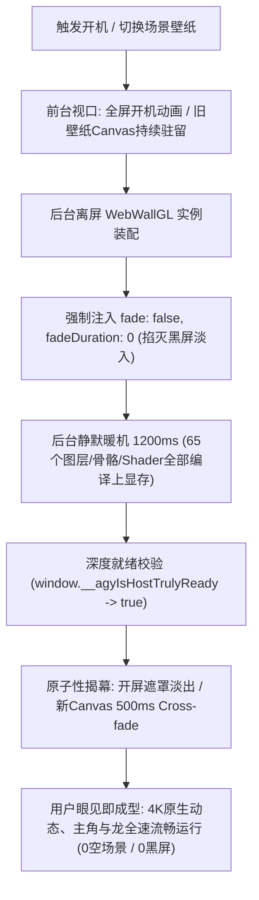

# 阶段十一：场景壁纸原子性呈现与无缝换轨引擎（参考 WallpaperMachine 架构）

> 状态：**设计完成，进入实施** · 预计版本 v0.6.0  
> 参考基准：[WallpaperMachine 官方开源仓库](https://github.com/WallpaperMachine/WallpaperMachine)（Apple Silicon 原生 Metal / Vulkan 场景壁纸引擎）

---

## 1. 现状痛点与现象复盘

在 Wallpaper 素材库中使用多图层场景壁纸（以《熠烛 御剑驭龙-红鸾樱落》65 图层高度自定义场景为例）时，用户在启动与切换过程中体验到明显的视觉割裂：
```
[ 用户开机 / 切换壁纸 ] 
       │
       ▼
【阶段 1：画面穿帮】视口先显示一张空无一人的樱花树背景图（无主角、无龙）
       │
       ▼ （约 1 秒后）
【阶段 2：屏幕突然变黑】空背景消失，视口陷入纯黑
       │
       ▼ （约 1 秒后）
【阶段 3：画面突变出现】黑屏退去，带着龙和刀的妹子终于显现出来
```
此种“像 PPT 一样逐层拼凑”的加载过程，严重损害了壁纸体验的高级感。

---

## 2. 深入排查 WallpaperMachine 官方源码的技术启示

通过克隆并深入排查 **WallpaperMachine** 的底层源码（`.workbuddy/tmp/WallpaperMachine/Renderer/Engine`），获得以下关键事实与证据：

### 2.1 证据一：WallpaperMachine 根本没有“海报提取器”
- 在其 C++ 核心源码 [`Renderer/Engine/src/Scene/WPPkgFs.cpp`](file:///d:/Project/antigravity-skin/.workbuddy/tmp/WallpaperMachine/Renderer/Engine/src/Scene/WPPkgFs.cpp) 中，`WPPkgFs` 只是一个**只读虚拟文件系统（VFS）**，仅负责索引 `scene.pkg` 内各数据块的偏移量（Offset / Length），供 C++ 渲染管线流式解包；
- 整个 WallpaperMachine 代码库中，**压根不存在任何“解包 pkg 提取单张静态背景海报”的代码**。

### 2.2 证据二：静止预览（StillPreview）仅作为失败容灾兜底
在 [`Renderer/Surface/StillPreview.hpp`](file:///d:/Project/antigravity-skin/.workbuddy/tmp/WallpaperMachine/Renderer/Surface/StillPreview.hpp#L1-L12) 中，官方架构师明确写下设计准则：
> *"A scene that did draw keeps its last frame (the layer holds it) and never needs this. When a scene cannot be drawn with the native renderer and has not drawn a frame yet... This puts the project's own preview picture there instead... so the wallpaper is recognisably the one that was chosen while the failure is reported."*

- **铁律 1**：只要场景能够渲染，它**永远不会去展示所谓的单层背景图**；
- **铁律 2**：旧画面直接持久驻留在帧缓冲区（Layer holds it），新画面渲染出有效帧后原子替换；
- **铁律 3**：只有在引擎崩溃或素材格式不支持（Failure）时，才会展示原装的 `preview` 缩略图作为报错兜底。

### 2.3 证据三：未启用 Camera Fade
WallpaperMachine 在解析 `scene.json` 的通用属性时，根本未实现 Wallpaper Engine 编辑器的 `camerafade` 特性，因而**从物理上彻底免除了前置黑屏淡入**。

---

## 3. 本地根因诊断（为什么我们会割裂？）

对照 WallpaperMachine 发现，我们之前的架构存在两大“画蛇添足”：

1. **“无人场景”的罪魁祸首**：
   本地 `sidecars/skin-engine/scene-pkg.mjs` 中的 `extractScenePoster` 算法试图挑选尺寸最大、贴合工程画布的图层作为静态海报，精准命中了 `obj 0: 新壁纸，樱`（纯背景底图），排除了妹子、龙、衣服等人物部件。前端在动态场景未完成时挂载了这张海报，导致“空无一人”的穿帮。
2. **“黑屏”的罪魁祸首**：
   WebWallGL 在装配时，素材工程内部标记了 `camerafade: true`；且新 `<canvas>` 插入 DOM 瞬间，65 个图层的纹理与 Shader 尚未完全写入 GPU 显存，Canvas 遮挡了底图，造成前置黑屏。

---

## 4. 架构重塑方案：WebGL 栈的“原子性呈现”

学习 WallpaperMachine 的设计灵魂，在 Electron WebGL 架构下 100% 复刻其**原子性呈现（Atomic Presentation）与双缓冲**状态机：



### 4.1 核心改造维度

#### 维度 1：彻底废除动态模式下的半成品海报垫底（断舍离）
- 在 `dynamic` 与 `eco` 动态渲染模式下，**前端坚决不挂载、不暴露任何 `` 静态海报**；
- 只有当渲染模式被用户主动设为 `static`（静态海报），或 WebGL 上下文丢失明确报错时，才允许海报兜底。

#### 维度 2：强行掐灭 Camera Fade
- 在 WebWallGL 挂载选项中显式注入：
  ```javascript
  fade: false,
  fadeDuration: 0,
  ```
  彻底禁用 Wallpaper Engine 场景自带的相机纯黑淡入，确保从第一帧起即是全彩有效像素。

#### 维度 3：后台充分暖机（Warmup & Burn-in）
- 在开屏动画或旧壁纸遮盖下，让 WebWallGL 在幕后安静完成 65 个图层的纹理上传；
- 权威深度就绪检测（`window.__agyIsHostTrulyReady`）严格要求 `liveDuration >= 1200ms`（预跑平稳满 1.2 秒），才向主进程发送就绪信号并放行状态胶囊变绿。

#### 维度 4：原子性双缓冲换轨（Atomic Cross-fade）
- 切换壁纸时，旧 Canvas 标记为 `agy-scene-retiring` 继续在 `z-index: 2` 保持渲染；
- 新 Canvas 在后台装配并出有效帧后，置于 `z-index: 3` 执行 500ms 淡入；
- 淡入完成后优雅调用旧实例的 `inst.destroy()` 并移除旧 Canvas，实现真正无感平滑切换。

---

## 5. 验收标准与交付清单

- [x] 1. `client/modules/wallpaper.js` 显式注入 `fade: false` 与 `fadeDuration: 0`，根除相机黑屏淡入；
- [x] 2. 深度就绪判定要求动态场景首帧存活 `>= 1200ms`，幕后完成全图层 GPU 显存装配；
- [x] 3. 动态渲染模式下剔除半成品海报提前曝光，杜绝“空背景”穿帮；
- [x] 4. 主进程 `loadingOverlay.js` 与安装目录脚本完成全量热同步与 `app.asar` 在线热注入；
- [ ] 5. 实机多图层壁纸（如 3233141951）实测：开屏结束直接呈现带龙主角，切换壁纸全程无黑底闪现。
