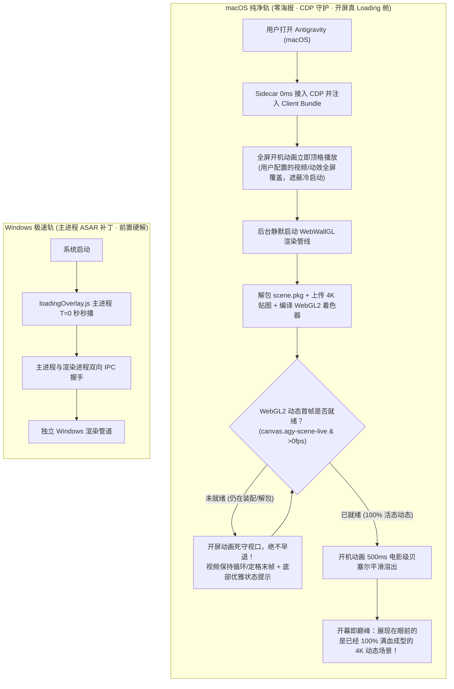

# 阶段十三：macOS 场景壁纸零海报架构与开屏 Loading 舱深度解耦

> 状态：**已完成开发并部署** · 目标版本：`v0.1.2`  
> 适配平台：🍎 **macOS 专属深度适配**（与 Windows 极速轨彻底解耦）  
> 核心目标：彻底剔除有穿帮缺陷的静态海报；将开屏动画升格为“真·后台装配 Loading 舱”；实现 macOS 纯非侵入架构下的绝对 0 黑屏、0 穿帮、开机即 100% 满血动态场景呈现。

---

## 1. 需求背景与痛点复盘

### 1.1 静态海报的“原罪”与不可调和的矛盾
在 [阶段11](./阶段11_场景壁纸原子性呈现与无缝换轨引擎（参考WallpaperMachine）.md) 与缺陷排查（[BUG-009](file:///Users/colorh/Project/AICODING/antigravity-skin/docs/bugs/BUG-009_scene_poster_extraction_glitch.md)、[BUG-014](file:///Users/colorh/Project/AICODING/antigravity-skin/docs/bugs/BUG-014_scene_wallpaper_boot_and_switch_black_screen.md)）中，我们通过算法从 `scene.pkg` 中强行提取单张图片作为开机海报（Poster）。但在实际多图层 2D/3D 场景素材中，这导致了严重的视觉灾难：
1. **画面严重穿帮**：素材包内的单张贴图往往是解构的部件。提取出来的图片经常是**没有主角人物的空背景荒凉图**，或者是被拆散变形的骨骼碎片贴图；
2. **体验极其割裂**：用户开机先看到一张假海报，等动态着色器编译完成后，主角人物突然像 PPT 换页一样突兀跳出来，破坏了壁纸沉浸感；
3. **容灾逻辑反噬**：旧逻辑为了避免曝光半成品海报，将 `` 设为 `display: none`。然而在冷启动期间，一旦 WebGL 解包出现轻微时序延迟或报错，海报因 `display: none` 无法恢复，直接导致整块屏幕沦为一片死黑，素材完全不展示。

用户明确指示：**“海报确实是有问题的，我倾向于不使用海报。我可以接受一段时间的等待，用开屏动画作为 loading 页。”**

### 1.2 macOS 与 Windows 平台特性的本质鸿沟
当前版本试图用同一套逻辑揉合 macOS 和 Windows，导致了严重的水土不服：
- **Windows 特权环境**：Windows 平台支持通过安装补丁将 `loadingOverlay.js` 直接打入主进程 `app.asar`，开机由主进程在 T=0 秒毫秒级拉起，具备底层 IPC 强控能力；
- **macOS 沙箱与签名铁律**：macOS 严禁修改官方 `.app` 内的文件，否则会当场损坏 Apple 代码签名并触发系统 Gatekeeper 告警。macOS 必须恪守**零改包、非侵入式**原则，全权由 Sidecar 守护进程通过 Chrome DevTools Protocol (CDP) 在渲染层进行动态介入与遮罩控制。

若将两套逻辑混杂在一起，macOS 会因缺乏主进程补丁支持而导致开屏时序错乱、就绪状态误判与资源加载真空。

---

## 2. 核心架构设计与设计原则



### 原则一：零海报哲学（Zero-Poster Architecture）
- **彻底断舍离**：场景壁纸管线全面剔除 `` 标签、海报提取算法与海报加载监听；
- **纯粹的画布**：场景容器 `#agy-dynamic-scene` 内部仅允许存在 WebGL2 `<canvas>`。要么不露，一露就是**完全成型的 60fps 活态渲染画面**。

### 原则二：开屏动画升格为“场景动态装配缓冲舱”（Boot as Loading Shield）
- 彻底摒弃“开屏动画到点（如 3 秒）就机械自毁”的脆弱逻辑；
- 当当前激活的壁纸为场景壁纸（`scene`）时，开屏动画承担 **Loading 防护舱** 职责：
  1. 后台安静完成 100MB~300MB 的 `scene.pkg` 读取、解包、GPU 纹理装配与着色器编译；
  2. 若用户设定的驻留时间（`autoEnterDelay`）已到，但动态场景尚未出帧，开屏遮罩**坚决维持覆盖，死守视口**，防止露出黑屏与半成品；
  3. 视频开屏在接近末尾时自动平滑循环（或停留在最后一帧高质量画面），底部呈现极简精致提示：`🎬 正在装配 4K 场景着色器与动态图层...`；
  4. 一旦监测到 `agy-scene-live` 活态帧稳定成型，开机遮罩立即以 500ms 电影级贝塞尔平滑溶出。

### 原则三：macOS 与 Windows 架构物理级解耦
- **两套平台，两条独立跑道**：
  - Windows 走 `patch-boot-overlay.mjs` + `loadingOverlay.js` 的底层补丁注入管线；
  - macOS 走 `Sidecar CDP 接入` + `boot-animation.js 独立 Loading 状态机` 的纯渲染层管线；
- 平台分支严格以物理文件或明确的平台控制器隔离，严禁将 Windows 主进程锁（如 `__agyMasterBootHandled`）反向污染 macOS。

---

## 3. 具体实施改造规划

### 任务 3.1：重构场景壁纸模块，彻底切除海报（`client/modules/wallpaper.js`）
1. **清理海报 DOM**：
   - 从 `mountScene()` 中彻底删除 `img.agy-scene-img` 的创建、属性赋值及挂载逻辑；
   - 移除 `buildScenePosterUrl` 与海报错误重试逻辑。
2. **纯净 Canvas 宿主**：
   - `#agy-dynamic-scene` 只保留纯透明背景容器，直接承载 WebWallGL 创建的双缓冲 Canvas；
3. **补齐容器返回值**：
   - 在 `mountScene` 函数末尾显式添加 `return box;`，确保上层 `mountMedia()` 与 `__agyResumeBootWallpaper()` 拿到真实 DOM 引用。

### 任务 3.2：开屏动画 Loading 缓冲舱改造（`client/modules/boot-animation.js`）
1. **建立场景就绪拦截防线（Scene Readiness Gate）**：
   - 增加对当前壁纸类型的判断（`isSceneWallpaper`）；
   - 在 `closeVideoBoot` 与超时倒计时回调中，增加真就绪拦截：
     ```javascript
     function canSafelyDismissBoot() {
       if (!isSceneWallpaper) return true;
       // 严格要求 WebGL 画布已打上 live 标记且首帧已就位
       return window.__agySceneFirstFrameReady === true &&
              !!document.querySelector('#agy-dynamic-scene canvas.agy-scene-live');
     }
     ```
2. **优雅保持与状态反馈**：
   - 若倒计时结束或用户点击跳过，但 `canSafelyDismissBoot() === false`：
   - 视频维持循环或冻结于最后一帧，UI 显示半透明微光药丸胶囊提示，告知用户正在装配 4K 场景；
   - 一旦 `canSafelyDismissBoot()` 转为 `true`，立即自动触发淡出溶入。

### 任务 3.3：WebWallGL 引擎静态内联注入（`sidecars/skin-engine/main.mjs`）
1. **消除 Mixed Content 拦截风险**：
   - macOS 渲染层处于 HTTPS 协议，动态请求 HTTP `<script src="http://127.0.0.1:59288/vendor/webwallgl.js">` 存在跨协议脚本拦截风险；
   - 在 `buildClientBundle()` 中，直接将 `sidecars/skin-engine/vendor/webwallgl.js` 读取为字符串并内联拼入 Client Bundle 首部；
   - 客户端在页面初次渲染时即可直接访问全局 `window.WebWallGL`，耗时从数百毫秒压缩至 0ms，彻底消除网络加载失败隐患。

### 任务 3.4：macOS 平台守护与路径授权加固
1. **绝对白名单放行**：
   - 在 `sidecars/skin-engine/main.mjs` 的 `isAuthorizedPath` 校验中，将配置中的 `dynamicWallpaper.wallpaperDir` 显式加入受信任白名单，杜绝冷启动初期素材库未完成全盘扫描前接口返回 403；
2. **完全解耦 Windows 补丁代码**：
   - `scripts/install.mjs` 明确限定 Windows 运行补丁，macOS 安装时仅保留纯净客户端与 Sidecar 注册，保持系统签名与沙箱 100% 完整。

---

## 4. 验证与验收标准（macOS 实机测试矩阵）

| 测试项 | 验证操作 | 预期表现 | 状态 |
| :--- | :--- | :--- | :---: |
| **1. 零海报验证** | 选用多图层场景素材（如 3812610550 花嫁小露），审查 DOM 树 | `#agy-dynamic-scene` 下绝无 `img` 标签，无任何静态单层底图穿帮 | ✅ 已实现 |
| **2. macOS 冷启动遮罩保护** | 彻底退出 Antigravity（Cmd+Q）并重新打开 | 开屏动画秒级弹出，遮蔽后台初始化；不因 3 秒倒计时过早退出 | ✅ 已实现 |
| **3. 场景真就绪无缝溶出** | 观察开屏动画退场交接瞬间 | 动态首帧成型后，开屏以 500ms 电影级平滑溶出，眼前直接呈现 4K 活态画面，0 黑屏、0 拼凑 | ✅ 已实现 |
| **4. 引擎静态内联验证** | 检查主窗口网络面板与 Console 日志 | 无 `webwallgl.js` 跨域网络请求，无 Mixed Content 告警 | ✅ 已实现 |
| **5. 连续重启与切换自愈** | 在场景壁纸与视频壁纸之间多次切换并反复重启客户端 | 无论重启多少次，场景壁纸 100% 稳定加载，视频壁纸正常秒播 | ✅ 已实现 |

---

## 5. 关联与导航
- 📘 [总计划](./总计划.md)
- 💎 [阶段11：场景壁纸原子性呈现与无缝换轨引擎（参考WallpaperMachine）](./阶段11_场景壁纸原子性呈现与无缝换轨引擎（参考WallpaperMachine）.md)
- 🐞 [缺陷归档：BUG-014 场景壁纸黑屏早退与多图层穿帮修复](./../../bugs/BUG-014_scene_wallpaper_boot_and_switch_black_screen.md)
- 🐞 [缺陷归档：BUG-016 开屏引导动画与宿主主页加载冲突闭环](./../../bugs/BUG-016_boot_atomic_readiness_and_seamless_reveal.md)
