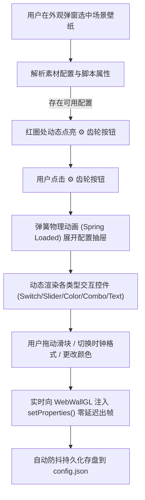

# 阶段十二：场景脚本配置面板（参考 WallpaperMachine）与时钟日期激活需求说明书

> **文档状态**：需求提案与架构设计（待评审）  
> **参考对标**：[WallpaperMachine/WallpaperMachine (GitHub)](https://github.com/WallpaperMachine/WallpaperMachine) · Wallpaper Properties & Inspector  
> **涉及核心文件**：
> - [`client/modules/appearance-menu.js`](file:///d:/Project/antigravity-skin/client/modules/appearance-menu.js)（外观设置与齿轮按钮、弹簧加载面板）
> - [`client/modules/wallpaper.js`](file:///d:/Project/antigravity-skin/client/modules/wallpaper.js)（SceneScript 执行通道、`setProperties` 动态热更管道）
> - [`sidecars/skin-engine/vendor/webwallgl.js`](file:///d:/Project/antigravity-skin/sidecars/skin-engine/vendor/webwallgl.js)（WebWallGL 渲染引擎运行时）
> - [`config.default.json`](file:///d:/Project/antigravity-skin/config.default.json)（壁纸专属参数持久化）

---

## 1. 需求背景与目标

### 1.1 现状与痛点
1. **时钟/日期“完全读不了”**：  
   场景壁纸（Scene 类型）中的数字时钟、日期日历、昼夜循环等特性，依赖 SceneScript（ECMAScript）的每帧 `update()` 计算与系统时间（`new Date()`）读取。由于当前底层脚本引擎被全局硬编码关闭（`scripts: false`），导致时钟图层完全不运行，仅停留为空白或初始占位符（如 `<Clock>`）。
2. **场景脚本参数无法自定义**：  
   Wallpaper Engine 场景创作者在素材中提供了极其丰富的可调脚本参数（如：12/24小时制切换、是否显示秒、时钟字体颜色、粒子浓度、动画速度、文字内容等）。目前客户端完全没有参数调节入口，所有属性只能使用硬编码的初始默认值。
3. **缺乏直观的原生级交互**：  
   在外观设置中选择场景素材后，用户无法感知该素材支持哪些动态调节项，缺乏如同 Wallpaper Engine 或 macOS 知名开源客户端 **WallpaperMachine** 那样的**属性检查器（Property Inspector）**。

### 1.2 对标参考：WallpaperMachine 是怎么做的？
根据对 `WallpaperMachine` 架构的深度剖析，其核心设计原则包括：
1. **Authored Properties 反射解析**：自动解析壁纸中的配置定义（支持 `project.json` 的 `general.properties` 与 SceneScript 动态创建的 `scriptProperties`）；
2. **多态控件自动映射**：根据属性类型自动生成对应的 UI 控件（Switch 开关、Slider 滑块、Color 调色盘、Combo 下拉菜单、Text 文本框）；
3. **Live Tweak 即时热响应**：用户调整任一控件时，无需重载壁纸，通过引擎层接口实时注入，画面所见即所得；
4. **Per-Wallpaper 属性独立持久化**：以壁纸 ID 为键值存储个性化配置，再次选用时无缝复原；
5. **一键恢复默认（Reset to Defaults）**：支持随时复原创作者初始设计。

---

## 2. 界面与交互设计（UI/UX）

### 2.1 齿轮按钮位置（定位与显隐规则）
参考用户提供的界面标注（红圈位置）：


1. **挂载位置**：  
   在「当前动态壁纸」行内：
   - 位于「当前动态壁纸」标题右侧、壁纸名称前方的醒目位置；
   - 呈现为一个精致紧凑的微交互齿轮图标按钮（`agy-btn-scene-props`，含 `title="场景脚本与自定义属性配置"`）。
2. **条件显隐**：  
   - 当素材类型为 **Scene（场景）** 且检测到存在脚本属性时，该齿轮按钮**显式高亮展示**；
   - 当素材为静态视频（Video）或纯图片时，齿轮按钮自动隐藏或平滑淡出，不干扰用户。

### 2.2 弹簧加载动效（Spring-loaded Expansion）
用户点击该齿轮按钮后：
1. **齿轮动效**：齿轮图标触发顺滑自旋过渡（`transform: rotate(90deg)`，耗时 280ms）；
2. **面板展开（Spring Physics）**：  
   在当前壁纸信息行下方，采用**弹簧阻尼曲线**（`cubic-bezier(0.175, 0.885, 0.32, 1.275)`）平滑向下展开独立的「场景脚本配置面板（Scene Properties Inspector）」；
3. **收起机制**：再次点击齿轮，或点击面板右上角收起图标时，面板以弹性动效向上回缩折叠。



---

## 3. 详细功能架构与技术实现方案

### 3.1 属性元数据提取与解析层
1. **静态属性源（`project.json`）**：
   - 提取 `general.properties` 中定义的每一项：
     - `text` / `label`：用户界面展示名称（支持多语言词条自动回退解析）；
     - `type`：`bool` | `slider` | `color` | `combo` | `text`；
     - `value`：作者设定的默认值；
     - `min` / `max` / `step` / `precision`：数值型约束；
     - `options`：下拉选项列表 `[{ label, value }]`；
     - `order`：显示排列权重（升序排序）。
2. **动态脚本属性源（`scriptProperties`）**：
   - 启动 SceneScript 引擎后，WebWallGL 执行 `createScriptProperties()`，生成动态脚本属性集，与静态属性自动合并。

### 3.2 动态控件映射表（UI Control Factory）

| 属性类型 (`type`) | 渲染控件形态 | 交互与即时响应逻辑 |
|:---|:---|:---|
| **`bool`** | iOS 风格平滑切换 Switch | 点击即时翻转布尔值，用于：时钟显隐、24小时制、显示秒钟、天气雨雪开关等。 |
| **`slider`** | 渐变滑条 + 实时数值气泡 | 拖动实时联动（加 16ms rAF 节流），用于：字体大小、动画速度、粒子密度、时钟透明度。 |
| **`color`** | 取色块 + 原生 HTML5 Color Picker | 点击弹出调色器，RGB 归一化向量（`"1.0 1.0 1.0"` $\leftrightarrow$ `#FFFFFF`）自动转换，用于：时钟文字颜色、发光特效等。 |
| **`combo`** | 毛玻璃圆角下拉选择框 Select | 选项即时切换，用于：时钟样式选择、语言切换、预设主题风格等。 |
| **`text`** | 紧凑文本输入框 Input | 输入即时生效（防抖 200ms），用于：自定义时钟问候语、用户名字等。 |

### 3.3 实时热更与引擎管道连接
1. **核心通信方法**：
   - 前端通过 `window.__agyWallpaperInstance.setProperties({ [propKey]: propValue })` 触发 WebWallGL 原生接口；
   - 场景脚本（SceneScript）中的 `applyUserProperties(properties)` 及着色器常量即刻响应，**无需刷新或重新加载素材，无黑屏，零闪烁**。
2. **时钟日期专用系统注入**：
   - 将 `scripts: true` 正式启用；
   - 实时维护归一化日进度 `timeOfDay = (hours * 3600 + minutes * 60 + seconds) / 86400`；
   - 场景内的 `new Date()` 即可自然工作，同时兼容各类自定义时钟脚本。

### 3.4 专属配置持久化方案
1. **存储模型**：
   - 在客户端主配置文件 `config.json` 的 `features.dynamicWallpaper` 下增加：
     ```json
     "wallpaperUserProperties": {
       "1982409329": {
         "use24hFormat": true,
         "showSeconds": false,
         "clock_font_color": "0.2 0.8 1.0"
       }
     }
     ```
2. **生命周期衔接**：
   - 每次切换到该壁纸时，优先读取该壁纸存储的自定义配置；若无则回退到作者默认值；
   - 面板提供「↺ 恢复作者默认」按钮，一键清空个性化覆盖并复原。

---

## 4. 安全与性能保障

1. **沙箱边界强化**：
   - 沿用并审计 WebWallGL 的 `new Function` 沙箱机制，彻底切断 `require`、`process`、`fs`、`fetch` 等 Node/Electron 敏感对象，仅保留单纯的数学与日期计算环境。
2. **面板懒加载与无损性能**：
   - 未点击齿轮前，不创建任何多余的 DOM 节点；
   - 面板折叠状态下完全脱离渲染流，不增加任何常驻内存与重绘成本。

---

## 5. 验收标准清单

| 序号 | 验收场景 | 预期行为 |
|:---|:---|:---|
| 1 | **齿轮按钮呈现** | 选用场景壁纸时，红圈处清晰呈现 ⚙️ 齿轮按钮；切换至视频壁纸时，齿轮按钮平滑隐藏。 |
| 2 | **弹簧加载动效** | 点击齿轮按钮，配置面板以弹簧弹性阻尼动效自然滑出；齿轮产生 90° 旋转反馈。 |
| 3 | **时钟脚本参数调节** | 以带有时钟的壁纸为例，调整「24小时制」或「字体颜色」开关，壁纸上的时钟画面秒级实时变色或变格式。 |
| 4 | **原生时间流动** | 场景内时钟文本脱离 `<Clock>` 占位状态，真实显示当前系统时间，秒针/分针随现实时间匀速跳动。 |
| 5 | **设置持久化与复原** | 修改参数后关闭设置弹窗或重启客户端，壁纸配置依然保持；点击「恢复默认」可瞬间恢复作者预设。 |

---

## 6. 实施步骤规划（待确认后启动）

1. **Step 1 - 后端数据支持**：在 `sidecars/skin-engine` 的壁纸信息读取中，附带返回 `project.json` 的 `properties` 字典元数据；
2. **Step 2 - UI 齿轮与弹簧容器**：在 `appearance-menu.js` 红圈位置插入齿轮按钮，构建弹簧动画抽屉容器（`agy-scene-props-drawer`）；
3. **Step 3 - 动态表单工厂**：编写控件渲染函数（Switch、Slider、Color、Combo、Text）；
4. **Step 4 - 引擎桥接与时钟激活**：打通 `wallpaper.js` 的 `scripts: true`，连接 `setProperties` 实时热更与 `config.json` 自动落盘；
5. **Step 5 - 真机联合验收**：使用真实带有丰富属性和时钟的工坊壁纸进行全面验证。
