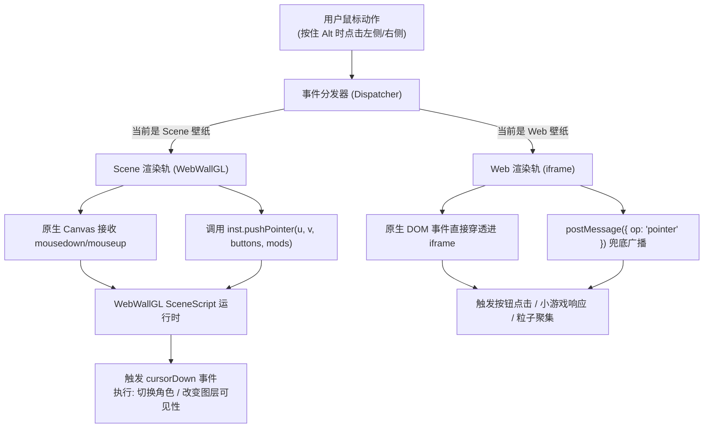

# 阶段 02：WebWallGL 点击响应与双轨事件网桥

> 状态：**设计就绪（待实施）**　|　版本：v0.2.0　|　前置依赖：[阶段 01：修饰键监听状态机与层级穿透引擎](./阶段01_修饰键监听状态机与层级穿透引擎.md)
>
> 📌 **核心目标**：针对 **Scene 场景壁纸（WebWallGL 引擎）** 与 **Web 网页壁纸（HTML5/Iframe 引擎）** 两种异构形态，建立双轨事件网桥。打通 SceneScript 中的鼠标点击（`cursorDown`、`cursorClick`）与射线碰撞判定，完美支持**“点击壁纸左/右侧切换人物立绘”**等经典创意工坊交互需求。

---

## 1. 异构形态交互需求与原理剖析

### 1.1 Scene 场景壁纸（WebWallGL）的点击机制
Wallpaper Engine 的创意工坊壁纸中，大量高质量模型与立绘壁纸包含如下交互逻辑：
- **左右区域点击切换角色**：
  在 SceneScript 脚本中，创作者通常监听 `cursorDown(event)`：
  ```javascript
  'use strict';
  export function cursorDown(event) {
    // 判定点击位置是否在屏幕左侧或右侧
    if (event.worldPosition.x < 0) {
      thisLayer.previousCharacter(); // 切换上一位角色
    } else {
      thisLayer.nextCharacter();     // 切换下一位角色
    }
  }
  ```
- **角色部位点击与骨骼表情反馈**：
  点击人物头部、身体时，通过射线检测（Raycast）触发特定微动效或语音播放；
- **水面波纹与粒子激荡**：
  鼠标按下时生成 Ripple 涟漪或引力斥力点。

**WebWallGL 内部支撑现状**：
在 `webwallgl.js` 中，核心对象已经内置了指针控制器接口：
```javascript
// WebWallGL 实例原生方法
instance.pushPointer(u, v, buttons, mods); // u, v 为 0~1 归一化坐标；buttons: 1 为左键；mods: 修饰键掩码
instance.pointerLeave();                   // 光标离开画布
instance.pushWheel(dx, dy, mode, mods);    // 滚轮事件
```
当壁纸 Canvas 获得点击或调用 `pushPointer` 时，WebWallGL 内部的 `__wePushPointer` 会准确触发内部虚拟事件，并分发给 SceneScript 的 `cursorDown`、`cursorUp` 和 `cursorClick`！

### 1.2 Web 网页壁纸（HTML5 / Iframe）的点击机制
- Web 壁纸运行在独立的 `<iframe>` 沙箱中；
- 内部可能是由 Canvas（Pixi.js / Three.js / Phaser）构建的小游戏，或是常规 HTML DOM 元素；
- 在按住修饰键且应用了层级穿透后，由于 `<iframe>` 的 `pointer-events: auto` 且置于顶层，原生鼠标事件直接由浏览器内核分发到 iframe 内部；
- 同时，通过双向安全 postMessage 广播 Wallpaper Engine 标准光标协议：
  ```javascript
  iframe.contentWindow.postMessage({
    __we: 1,
    op: 'pointer',
    x: e.clientX,
    y: e.clientY,
    b: e.buttons,
    m: e.altKey ? 4 : 0
  }, '*');
  ```

---

## 2. 双轨事件网桥架构



---

## 3. 核心实现规范

### 3.1 坐标归一化计算
针对 WebWallGL 视口，计算高精度 `[0, 1]` 归一化坐标（与 CSS 视口比例和 DPR 自动对齐）：
```javascript
function dispatchScenePointer(inst, event, isUp = false) {
  if (!inst || typeof inst.pushPointer !== 'function') return;
  const rect = inst.canvas ? inst.canvas.getBoundingClientRect() : { left: 0, top: 0, width: window.innerWidth, height: window.innerHeight };
  const u = (event.clientX - rect.left) / rect.width;
  const v = (event.clientY - rect.top) / rect.height;
  const buttons = isUp ? 0 : (event.buttons || 1);
  const mods = (event.ctrlKey ? 1 : 0) | (event.shiftKey ? 2 : 0) | (event.altKey ? 4 : 0) | (event.metaKey ? 8 : 0);
  
  inst.pushPointer(u, v, buttons, mods);
}
```

### 3.2 滚轮事件（Wheel）穿透扩展
部分壁纸支持按住 Alt 时滚动滚轮缩放角色或切换场景：
```javascript
function handleWheelInteraction(event) {
  if (!isPierceActive) return;
  if (sceneRendererInstance && typeof sceneRendererInstance.pushWheel === 'function') {
    sceneRendererInstance.pushWheel(event.deltaX, event.deltaY, event.deltaMode, 4);
    event.preventDefault();
  }
}
```

---

## 4. 受影响文件清单

| 文件路径 | 变更类型 | 变更职责说明 |
| :--- | :---: | :--- |
| `client/modules/wallpaper.js` | 修改 | 在 `mountSceneDynamic` 中绑定 pointerdown/up 网桥，适配 `pushPointer` 路由 |
| `client/modules/wallpaper.js` | 修改 | 在 Web 轨增加 postMessage 与原生事件双向投递 |

---

## 5. 交付验收标准

- [ ] **Scene 壁纸点击切换人物**：载入包含多角色或左右切换箭头的场景壁纸，按住 `Alt` 点击左侧或右侧，人物立绘立即完成切换；
- [ ] **SceneScript 点击日志**：控制台可见 SceneScript 正常捕获 `cursorDown` 与 `cursorClick` 事件；
- [ ] **Web 壁纸小游戏与按钮**：载入含可交互控件的网页壁纸，按住 `Alt` 能成功点击控件、触发水波或操作解压小游戏；
- [ ] **光标释放不残留**：松开 `Alt` 或鼠标离开窗口时，自动触发 `pointerLeave()`，无黏连拖动现象。
