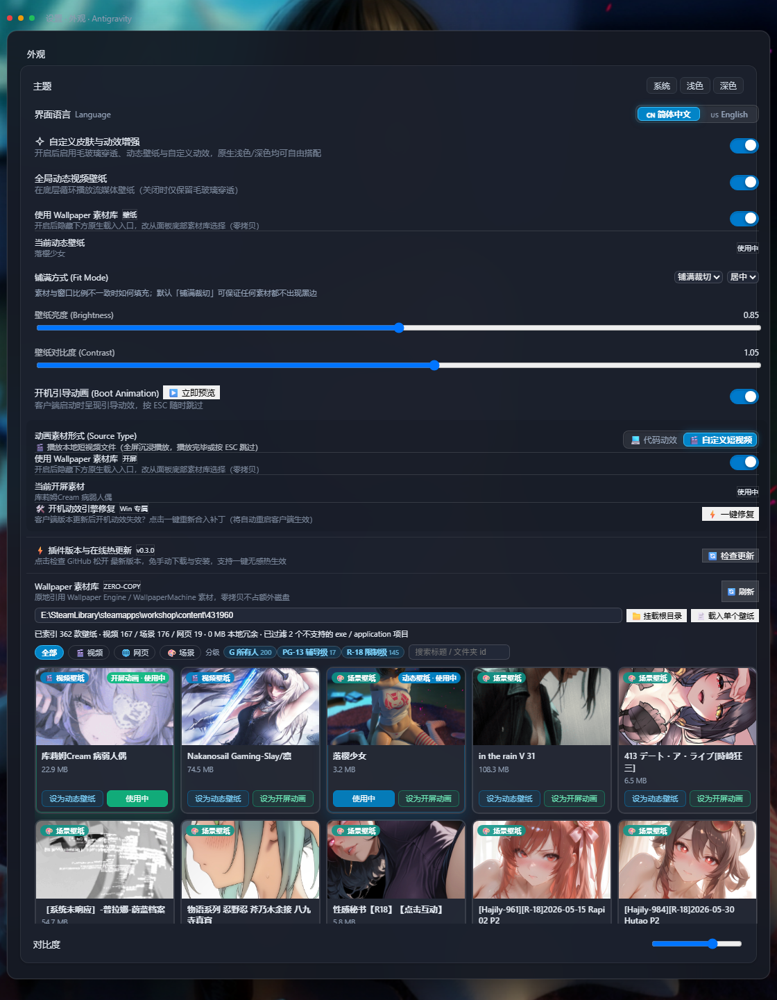

# Wallpaper 素材库集成 · 实现落地记录

> 本文件记录三阶段计划的**实际落地结果**、接口契约、验证数据与已知偏差，供后续迭代与代码审查对照。
> 规划原文见 [总计划](./总计划.md) / [阶段01](./阶段01_核心引擎与零拷贝后端管道.md) / [阶段02](./阶段02_前端资产中心与外观菜单改造.md) / [阶段03](./阶段03_多形态渲染适配器与体验打磨.md)。

## 0. 阶段状态总览

| 阶段 | 状态 | 交付物 |
| :--- | :---: | :--- |
| 阶段一：核心引擎与零拷贝后端管道 | ✅ 已完成 | `sidecars/skin-engine/wallpaper-library.mjs` + `main.mjs` 路由扩展 |
| 阶段二：前端资产中心与外观菜单改造 | ✅ 已完成 | `client/modules/wallpaper-library-ui.js` + `appearance-menu.js` 改造 |
| 阶段三：多形态渲染适配器与体验打磨 | ✅ 基本完成（1 项需宿主能力，见 §5） | `wallpaper.js` / `boot-animation.js` / `index.js` 多态渲染 |
| 阶段四：双开关交互重构与年龄分级筛选 | ✅ 已完成 | 双开关模型 + 原生区隐藏 + 双色选中态 + G/PG-13/R-18 分级筛选 |
| 阶段五：展陈几何与无黑边适配 | ✅ 已完成 | `wallpaper.js` 2.6 几何控制器 + 四模式展陈 + 外观菜单两个下拉 |
| 配置结构升级与向后兼容 | ✅ 已完成 | `config.default.json` + Sidecar `normalizeConfig()` 深合并补全 |

版本：`0.0.10` → `0.1.0`（三阶段）→ `0.2.0`（阶段四）→ `0.3.0`（阶段五）。

---

## 1. 阶段一：零拷贝后端管道

### 1.1 新增模块 `wallpaper-library.mjs`

| 导出函数 | 职责 |
| :--- | :--- |
| `parseWallpaperFolder(folderPath)` | 解析单个壁纸目录；类型归一化、入口/封面/音频推导、application 过滤 |
| `scanLibrary(rootPath, { force })` | 并发（8 路）扫描根目录，mtime 驱动缓存，返回 `wallpapers / filtered / stats` |
| `detectLibraryCandidates()` | 自动探测 Steam 创意工坊 `431960`、`libraryfolders.vdf` 多库路径、WallpaperMachine 默认库 |
| `resolveFolderByHint(hint, roots)` | 支持「绝对路径 / 根目录相对路径 / 仅工坊文件夹 id」三种定位方式 |
| `serveLocalFile(req, res, filePath, opts)` | 通用静态伺服：ETag / 304 / HEAD / HTTP 206 Range |
| `isSubPath(root, target)` | 跨盘符安全的目录包含判断（防穿越） |
| `clearScanCache()` | 手动清空扫描缓存 |

### 1.2 实际 HTTP 接口

| 接口 | 方法 | 参数 | 说明 |
| :--- | :---: | :--- | :--- |
| `/api/wallpaper-library/detect` | GET | — | 返回本机候选素材库 `[{ path, label, kind, count }]` |
| `/api/wallpaper-library/scan` | GET | `?path=&mount=1&force=1` | 扫描根目录；`mount=1` 同时把根目录持久化为 `libraryPath`；`force=1` 跳过缓存。`path` 支持绝对路径或目录名（自动在探测结果中匹配） |
| `/api/wallpaper-library/import-folder` | POST | `{ folderPath \| id, mount?: true }` | 挂载单个壁纸目录，返回装饰后的壁纸对象；application / 未知类型返回 `{ ok:false, filtered:true, reason }` |
| `/api/wallpaper-library/preview` | GET | `?folder=&file=` | 封面图流（jpg/gif/png/webp），`Cache-Control: public, max-age=86400`；目录须在白名单内 |
| `/api/wallpaper-library/audio` | GET | `?folder=&file=` | 场景/网页壁纸独立音频流，支持 Range |
| `/api/wallpaper-library/file` | GET | `?folder=&file=` | 通用壁纸文件读取（入口文件、scene.pkg 等） |
| `/api/wallpaper-library/web-proxy/<base64url(folder)>/<相对路径>` | GET/HEAD | — | Web 壁纸静态托管；相对子资源（`./static/js/*.js`）自动跟随同前缀解析；也兼容 `?folder=&file=` 形式 |
| `/api/video`、`/wallpaper.mp4`、`/boot-video.mp4` | GET | `?path=<绝对路径>` | 既有零拷贝流管道，外部绝对路径直接走 HTTP 206 |

### 1.3 解析与过滤规则

- **类型归一化**：真实素材库存在 `Web / web / Scene / scene / Video / video` 混写，统一 `toLowerCase()`。
- **严格排除**：`type === 'application'` 或 `project.file` 以 `.exe` 结尾 → 扫描阶段标记 `filtered`，永不返回可用资产。
- **入口推导顺序**：清单 `file` → 类型默认入口（`index.html` / 首个视频 / `scene.json|scene.pkg`）→ 浅层递归兜底。
- **封面推导顺序**：清单 `preview` → `preview.jpg|jpeg|gif|png|webp` → 目录内首个图片。
- **虚拟元数据**：无 `project.json` 但含视频/网页入口的目录，以文件夹名作标题并标记 `virtual: true`。
- **路径安全**：所有 `folder` 参数必须通过 `isAuthorizedPath()`（白名单 = `libraryPath` + `mountedFolders`），再经 `isSubPath()` 校验，双重防目录穿越。

### 1.4 真实库验证数据（`E:\SteamLibrary\steamapps\workshop\content\431960`）

| 指标 | 结果 |
| :--- | :--- |
| 子目录总数 | 364 |
| 可用壁纸 | **362**（video 167 / scene 176 / web 19） |
| 被过滤 | 2（`unknown-type`：无 `type`/`file` 的非壁纸目录） |
| 首次全量扫描 | **≈ 230–330 ms** |
| 命中缓存扫描 | **≈ 19–20 ms** |
| 单目录解析样例 | `3400422354` → `video` / `库莉姆Cream 病弱人偶.mp4` / `preview.gif` / 24.1 MB |
| 封面流 | `preview.gif` 880,356 B，`image/gif`，强缓存头正常 |
| Web 子资源 | `./static/js/main.b3270965.js` → 214,696 B，`application/javascript` |
| Range | `bytes 0-1023` → `206`，`Content-Range: bytes 0-1023/24059275` |
| 穿越攻击 | `file=../../../../Windows/win.ini` → `403` |
| 未授权目录 | `folder=C:\Windows` → `403` |
| 零拷贝 | `assets/videos/**` 无任何新增外部文件 |

---

## 2. 阶段二：资产中心与外观菜单

### 2.0 双开关模型（阶段四落地，取代原单开关）

动态壁纸与开屏动画各自拥有独立的「使用 Wallpaper 素材库」开关，任意组合合法：

```json
"externalWallpaperLibrary": {
  "wallpaperEnabled": false,
  "bootEnabled": false,
  "libraryPath": "",
  "autoScan": true,
  "mountedFolders": []
}
```

| 壁纸开关 | 开屏开关 | 壁纸原生选择区 | 开屏原生选择区 | 素材库区块 | 卡片按钮 |
| :---: | :---: | :--- | :--- | :--- | :--- |
| OFF | OFF | 显示 | 显示 | 隐藏 | — |
| ON | OFF | 隐藏 → 「当前动态壁纸 + 使用中」 | 显示 | 显示（在线更新下方） | 仅「设为动态壁纸」 |
| OFF | ON | 显示 | 隐藏 → 「当前开屏素材 + 使用中」 | 显示（在线更新下方） | 仅「设为开屏动画」 |
| ON | ON | 隐藏 | 隐藏 | 显示（在线更新下方） | 两个按钮 |

- **迁移**：旧配置 `enabled: true` 在 `normalizeConfig()` 中一次性映射为 `wallpaperEnabled` / `bootEnabled` 双开；随后旧字段被删除，不再写回。
- **位置**：`#agy-wallpaper-library` 固定插入在 `#agy-wrap-plugin-update` 之后；每次 `applyLibraryModeUI()` 校验 `previousElementSibling`，宿主重排后自动纠正。
- **不中断播放**：关闭某个开关只改变 UI 与候选来源，已应用的外部素材继续播放；原生下拉框以「📁 当前外部素材: 标题」占位回显。
- **卡片选中态**：动态壁纸 = 天蓝 `#0284c7` 描边 + 蓝色「动态壁纸 · 使用中」胶囊；开屏 = 翠绿 `#10b981` 描边 + 绿色胶囊；两者皆是 = 45° 蓝绿渐变描边（CSS mask 圆角边框）+ 双胶囊，对应按钮变为「使用中」并禁用。
- **按钮裁剪**：`wallpaperEnabled` 才渲染「设为动态壁纸」，`bootEnabled` 才渲染「设为开屏动画」；单按钮时 `flex:1` 撑满。

### 2.05 年龄分级筛选（对齐 WallpaperMachine）

后端 `normalizeRating()` 把 `project.json` 的 `contentrating` 归一化为 `everyone | questionable | mature | unknown`，缺失时按 Everyone 兜底并标记 `ratingInferred: true`；`scanLibrary().stats.byRating` 返回分档计数。

前端在工具栏提供三个 chip：`G 所有人` / `PG-13 辅导级` / `R-18 限制级`，语义与 WallpaperMachine 的 Installed 视图一致——**默认三项全选（不筛选），取消勾选即排除该档**。匹配始终使用原始英文标签，界面文案单独本地化。筛选偏好写入 `localStorage['agy.lib.ratingFilter']`，菜单重建或语言切换后保持。

真实库实测计数：Everyone 200（含 25 项缺失兜底） / Questionable 17 / Mature 145 = 362；取消 R-18 后状态行显示「已隐藏 145 款（分级）」。

### 2.1 新增模块 `wallpaper-library-ui.js`

以全局单例 `window.__agyWallpaperLibrary` 暴露：

| 方法 | 说明 |
| :--- | :--- |
| `init(container, ctx)` | 在 `#agy-wallpaper-library` 内渲染资产中心（开关由原生区块持有） |
| `isWallpaperEnabled()` / `isBootEnabled()` | 读取双开关 |
| `syncMode()` | 双开关变化后重绘按钮可见性与选中态，必要时首次加载 |
| `refresh(force)` | 重新扫描（`force=true` 清缓存） |
| `ensureLoaded(force)` | 幂等加载（任一开关开启时由菜单调用） |
| `getList()` / `getByKey(key)` | 资产列表与目录键查找 |
| `applyWallpaper(w)` / `applyBoot(w)` | 一键写入动态壁纸 / 开屏动画配置 |
| `rerender()` | 语言切换后重建骨架与卡片 |
| `syncPath()` | 同步路径输入框与状态行 |

界面能力：路径输入 + Enter 挂载、`📁 挂载根目录`、`📄 载入单个壁纸包`、`🔄 刷新`、探测推荐路径（一键使用）、状态行（总数 / 分类型 / 过滤数 / 分级隐藏数 / 0 MB 冗余）、类型筛选 chips、分级 chips（含计数）、标题搜索、每页 20 张带翻页器分页、卡片封面（GIF 动态与静态首帧冻结）、类型徽章、体积/作者、按开关裁剪的应用按钮、双色选中态。

### 2.15 分页与资源懒加载落地（一页 20 款 + 总数带翻页）

原先采用的「显示更多」单向累加瀑布流在 300+ 壁纸库中会导致 DOM 节点急剧增长，占用过多内存与 GPU 显存，且滚动定位体验欠佳。现已升级为**固定每页 20 款 + 显式总数与完整翻页控制器**：
- **分页控制器能力**：
  - **总数与页码回显**：实时显示「共 ${totalCount} 款 · 第 ${currentPage} / ${totalPages} 页」（单页时仅显示统计，无冗余翻页按钮）；
  - **完整翻页组件**：首页（`«`）、上一页（`‹`）、智能数字页码胶囊（当前页邻近页码 + 省略号高亮展示）、下一页（`›`）、末页（`»`）；
  - **直接跳页**：提供数字输入框，按 Enter 或失焦即刻直接跳转至目标页码；
  - **状态重置**：切换类型筛选、分级筛选或输入搜索关键字时，当前页码自动归 1；
  - **翻页平滑置顶**：切换页码时，自动平滑将网格滚动容器置顶（`scrollTop = 0`）。
- **资源懒加载机制**：
  - **DOM 常驻上限严格控制**：网格内永远仅渲染当前页的至多 20 个卡片 DOM 节点，换页时旧节点随 `grid.innerHTML` 完全从 DOM 树卸载并销毁，内存占用保持低恒定；
  - **图像原生按需懒加载**：卡片封面 `` 标签配备 `loading="lazy"` 与 `decoding="async"`，仅对视口内的图像发起网络请求并异步解码；
  - **动态图 GIF 首帧冻结与无泄漏**：当前页中的 GIF 封面自动提取首帧 Canvas 冻结，翻页切离时伴随卡片 DOM 一并被浏览器垃圾回收，杜绝多 GIF 跑满 CPU。



> 上图为阶段四真实渲染截图（无头 Chromium + 真实侧车 + 真实 `E://SteamLibrary` 素材库）：双开关均开启、评级 chips 显示 200/17/145；首卡同时作为动态壁纸与开屏动画（蓝绿渐变描边 + 双胶囊），第三张为当前动态壁纸。

### 2.2 与原生下拉框的关系（阶段四收敛）

- 库模式下原生下拉框**整体隐藏**（连同上传播放入口与删除按钮），不再向其中注入外部素材分组，避免出现两条选择路径。
- 原生下拉框只维护内置素材：`── 动态壁纸素材库 ──` / `── 可复用开机素材库 ──`。
- 关闭开关但当前仍在播放外部素材时，下拉框以「📁 当前外部素材: 标题」占位回显，删除按钮对该值保持禁用；`handleDeleteVideo` 二次拦截并提示不删除原始文件。

### 2.3 目录选择器的现实约束与降级

新版 Electron 已移除 `File.path`，`<input webkitdirectory>` 无法直接拿到绝对路径。因此采用三级降级：

1. `file.path`（旧版 Electron）→ 直接使用；
2. `window.electronNative.getPathForFile(file)`（若宿主暴露）→ 使用；
3. 仅取 `webkitRelativePath` 顶层目录名 → 交给 Sidecar 在**已探测的库根目录**中匹配（`scan?path=<目录名>` / `import-folder` 均支持）。

同时提供「文本框粘贴绝对路径 + Enter」与「自动探测推荐路径」两条 100% 可靠的路径，避免依赖不可控的浏览器能力。

### 2.4 国际化

资产中心使用独立文案表（`zh` / `en`），语言切换时 `rerender()` 重建；`i18n-engine.js` 的宿主汉化逻辑不受影响，二者互不干扰。

---

## 3. 阶段三：多形态渲染与体验打磨

### 3.1 渲染容器互斥挂载（`wallpaper.js`）

| 形态 | DOM | 关键实现 |
| :--- | :--- | :--- |
| video | `<video id="agy-dynamic-video">` | 保持原硬件解码链路，`canplay` 后淡入 |
| web | `<iframe id="agy-dynamic-iframe">` | `sandbox="allow-scripts allow-same-origin allow-pointer-lock allow-popups"`，`pointer-events: none` 默认穿透，`z-index: -999999` |
| scene | `<div id="agy-dynamic-scene">` | 封面 + `agySceneKenBurns` 32s 缓动，`prefers-reduced-motion` 自动关闭动效 |

- **切换即销毁**：`mountMedia()` 在切换形态时显式 `pause()` → 清 `src` → `load()` → `remove()`，视频/iframe/场景/音频互斥，绝无残留节点。
- **滤镜统一**：三种形态均绑定 `brightness(var(--agy-bg-brightness)) contrast(var(--agy-bg-contrast))`，亮度/对比度滑块继续实时生效。
- **氛围音**：`<audio id="agy-dynamic-audio">`，仅在「场景 + 存在独立音频文件 + 用户开启」时挂载，音量 0.28、循环，开屏期间自动暂停。

### 3.2 开屏动画（`boot-animation.js`）

- 新增 `type: "scene"`：高清封面 + Ken Burns + 约 3.2s 自动淡出，支持 ESC / 点击跳过。
- **零闪烁交叉淡入**：视频 `timeupdate` 中检测剩余 ≤ 450ms 时，提前在底层挂载主界面壁纸（被不透明开屏层遮挡），开屏层再以 420ms 淡出，无黑底、无跳帧。
- **开屏期间挂起**：视频 `pause()`、iframe `visibility: hidden` + `postMessage`、场景层隐藏、氛围音暂停；结束时统一恢复。

### 3.3 性能守卫

- `visibilitychange → hidden`：立即挂起视频解码 / iframe 合成 / 音频。
- `window blur`（延迟 1.2s 且仅在页面真隐藏时）：挂起；`focus` 立即平滑唤醒。
- 主窗口 DOM 观察器对「任一形态存在」判定，避免形态切换后被误判为缺失而重复挂载。

---

## 4. 配置结构（向后兼容）

```json
{
  "features": {
    "dynamicWallpaper": {
      "enabled": true,
      "sourceType": "video",          
      "videoPath": "",                 
      "wallpaperDir": "",              
      "wallpaperId": "",               
      "entryFile": "",                 
      "previewFile": "",               
      "audioFile": "",                 
      "audioEnabled": false,
      "title": "",
      "brightness": 0.85,
      "contrast": 1.05
    },
    "bootAnimationConfig": {
      "type": "video",                 
      "customCodePath": "",
      "videoPath": "",
      "wallpaperDir": "",
      "previewFile": "",
      "wallpaperTitle": ""
    },
    "externalWallpaperLibrary": {
      "wallpaperEnabled": false,       // 动态壁纸使用素材库
      "bootEnabled": false,            // 开屏动画使用素材库
      "libraryPath": "",
      "autoScan": true,
      "mountedFolders": []
    }
  }
}
```

Sidecar 的 `normalizeConfig()` 做深合并：旧版 `config.json` 只会被补齐字段，不会被覆盖；仅有 `videoPath` 的旧配置自动推导 `sourceType = 'video'`；旧单开关 `enabled: true` 一次性迁移为双开关同开。`pack.mjs` 始终以 `config.default.json` 作为出厂配置，开发机上的真实库路径不会进入 Release 包。

---

## 5. 已知偏差与未纳入本轮的项

| 项 | 状态 | 说明 |
| :--- | :---: | :--- |
| Scene `scene.pkg` 解包 | ❌ 未实现 | 需完整解析 Wallpaper Engine 私有打包格式（含纹理/着色器/骨骼），工程量大且需商用解码器；本轮以「高清封面 + Ken Burns + 氛围音」呈现，符合阶段三「分级呈现」的基础档 |
| pkg 内嵌音频提取 | ❌ 未实现 | 仅支持目录内独立音频文件（`mp3/ogg/wav/m4a/flac`）；当前库中 5 个含独立音频的均为 `web` 类型，其网页自身负责播放 |
| 系统级桌面透射（纯透工作区） | ⏸ 待宿主能力 | 需要 Electron 窗口本身具备透明背景（`transparent: true`）。插件无法从渲染层改变宿主窗口属性，强行实现只会得到黑底，故本轮不做「假透射」；若后续宿主提供透明窗口开关，可直接复用现有 `#agy-wallpaper-backdrop` 移除逻辑 |
| Web 壁纸鼠标交互开关 | ⏸ 未提供 UI | 当前固定 `pointer-events: none`（不阻挡编辑器）。如需交互需在 `wallpaper.js` 暴露开关，属可选增强 |
| 视频 `mkv` 容器 | ⚠️ 受限 | Chromium 对 mkv 支持不稳定，建议优先 mp4/webm；不会对用户原始文件做任何转码或 faststart 改写（零拷贝原则） |

---

## 6. 开发与验证方式

```bash
# 1. 本地起 Sidecar（独立端口便于联调）
AGY_SKIN_PORT=59299 node --experimental-websocket sidecars/skin-engine/main.mjs

# 2. 真实库接口自测
curl --noproxy "*" "http://127.0.0.1:59299/api/wallpaper-library/detect"
curl --noproxy "*" "http://127.0.0.1:59299/api/wallpaper-library/scan?mount=1"

# 3. 客户端启动后热重载前端与 Sidecar（需先安装插件）
node scripts/sync-all.mjs
```

本轮已完成的自动化验证（无头 Chromium + 真实库 + 真实 Sidecar）：

- 资产中心挂载 362 项、状态行统计、封面 GIF 实际解码成功；
- 类型筛选（场景 24/页全为场景）、搜索（`Forest` → 2 项）、分页 24 → 48；
- 中英切换：`Wallpaper Library / Set as wallpaper` ↔ `Wallpaper 素材库 / 设为动态壁纸`；
- 视频壁纸自动播放；场景壁纸封面加载（1016px）且节点互斥；Web 壁纸 iframe 指向 web-proxy；
- 场景开屏 3.2s 自动结束；视频开屏 `readyState=4` 正常播放；
- 关闭动态壁纸后 `video / iframe / scene / audio` 全部归零；
- 浏览器控制台 0 error / 0 warn。

阶段四追加验证（无头 Chromium + 真实库，覆盖四种开关组合）：

| 组合 | 实测 |
| :--- | :--- |
| 双关 | `libHost=none`；`wallContent=flex`、`bootContent=flex`；两张卡 `cardButtons={}` |
| 仅壁纸 | `libHost=block`（`previousElementSibling=agy-wrap-plugin-update`）；`wallContent=none`、`wallActive=flex`；卡片按钮仅 `{wallpaper:24}` |
| 仅开屏 | `wallContent=flex`、`bootContent=none`、`bootActive=flex`；卡片按钮仅 `{boot:24}`；原生下拉框无外部库分组（仅 1 个当前值占位） |
| 双开 | 两个原生区均 `none`；`cardButtons={wallpaper:24, boot:24}`；同一卡应用两者后 `class="agy-lib-card is-both"`、双胶囊「动态壁纸 · 使用中 + 开屏动画 · 使用中」 |

- 单卡应用后：`is-wall` + 蓝色胶囊，使用中按钮置灰；再设为开屏 → `is-both` 渐变描边。
- 关掉某一开关：对应原生区立即恢复 `flex`，另一个保持 `none`，已应用素材继续播放。
- 分级 chips 实测计数：`G 200 / PG-13 17 / R-18 145`；取消 R-18 → 状态行「已隐藏 145 款（分级）」，`localStorage["agy.lib.ratingFilter"] = {"excluded":["mature"]}`，chip 变为未选中态。

---

## 7. 阶段五落地：展陈几何与无黑边适配

完整方案见 [阶段五-展陈几何与无黑边适配](./阶段05_展陈几何与无黑边适配.md)。

### 7.1 真正根因（与素材无关）

三种背景形态的几何写法在修复前不一致：`iframe` 用 `cssText` 内联写死、`scene` 用独立的 `#agy-scene-style`、**`video` 只用 `glass-theme.css` 里的 `#agy-dynamic-video`**。`realMountVideo()` 创建元素时只写 `opacity` 与 `transition`，没有任何尺寸与 `object-fit`。

样式注入链路存在三处可断点：`ensureStyle()` 在 CSS 字符串为空时直接 `return`；`updateStyle('')` 会把 `<style>` 内容清空；宿主重渲染移除 `<style>` 后存在 180ms 重挂窗口。

一旦显式尺寸丢失，宿主 Tailwind preflight 的 `img, video { max-width:100%; height:auto }` 立即接管，`<video>` 按「内容区宽 + 固有比例」回到文档流——视口比例不一致时就是黑边或溢出。**这解释了「有的会无法全屏」：取决于那次会话 CSS 是否成功注入，而非素材本身。**

次因：`width:100vw` 含纵向滚动条宽度（Windows 约 15–17px），会出现右侧被裁与横向溢出。

### 7.2 实现要点

- 新增 `wallpaper.js` **2.6 统一媒体几何控制器**：所有几何属性以 `!important` 内联写到元素自身，独立于任何外部 CSS；用 `top/right/bottom/left + 100%` 取代 `100vw/100vh`；`max-width/max-height: none` 专门反制 preflight。
- 新增四模式展陈 `dynamicWallpaper.fit`：`cover`（默认，无黑边）/ `blur`（模糊底 + 前景完整，无黑边不裁切）/ `contain` / `fill`；配套九宫格 `fitPosition`。
- `blur` 双层：`#agy-dynamic-video-backdrop`（`cover` + `blur(48px) brightness(.7) scale(1.16)`，`z:-999999`）与主视频（`contain`，同 `z` 靠 DOM 顺序压上层），8s 低频时间轴校正（阈值 0.4s）；**`readyState < 1` 时不预建模糊层**，坏链素材不会白拉第二路解码。
- 视口同步：`resize` / `orientationchange` / `fullscreenchange` + `ResizeObserver(documentElement)`，经 `rAF` 合帧，只重写几何不重建解码管道。
- `fit` 变更走独立 `fitKey` 热路径（不参与 `mediaKey`），调下拉框不会重挂视频。
- 场景壁纸 `cover` 沿用 CSS `inset:-2%/104%` 安全边供 Ken Burns 使用；切回 `cover` 时清除 `width/height` 但**必须保留 `max-width:none`**——否则 preflight 把 104% 压回 100%，实测泄漏 49.95px。

### 7.3 实测（真实 Chrome + CDP，`glassThemeCss:''` 复现样式缺失）

模拟宿主 preflight（`img,video{max-width:100%;height:auto}`）+ 强制纵向滚动条 + 3840×2558 真实 mp4。

| 用例 | 实测 | 结果 |
| :--- | :--- | :---: |
| 视频 + CSS 完全缺失 | rect 1249×625 = clientW/H | ✅ |
| 滚动条宽度 | 宽 1249 vs innerWidth 1264（差值未计入） | ✅ |
| 横向溢出 | `scrollWidth 1249 ≤ clientWidth 1249` | ✅ |
| 视口 2400×900 | 2385×900 跟随 | ✅ |
| `cover→blur` | 前景 `contain`，backdrop `cover` 生效 | ✅ |
| `blur→cover` | backdrop 释放为 `null` | ✅ |
| 场景 + blur | `agy-scene-bg` 存在，前景 `contain` | ✅ |
| 场景切回 cover | computed width **1298.95px**（1249×1.04），animation `agySceneKenBurns` | ✅ |
| 坏链 + blur | `readyState=0`，backdrop 未创建 | ✅ |
| 控制台 | 0 exception / 0 error | ✅ |

13 项判定全部通过。

### 7.4 边界

- **素材画面内部烧录的黑边无法消除**（像素内容，只能靠 `cover` 放大裁掉）。
- **`web` 壁纸只保证 iframe 容器铺满**：内部网页是否自适应由素材自身决定，强行 `transform: scale` 对 `100%` 自适应页面会触发重排回环，故不做注入。
- `blur` 为双路解码，功耗高于单路；`contain` 留边颜色跟随 `#agy-wallpaper-backdrop`（浅色白 / 深色 `#131313`）。

## 场景真实画面（scene-poster）修复 —— 2026-10-22

| 文件 | 改动 | 状态 |
|---|---|---|
| `sidecars/skin-engine/scene-pkg.mjs` | 新增：PKG/TEX 解包、材质链解析、LZ4→PNG、磁盘缓存 | ✅ |
| `sidecars/skin-engine/main.mjs` | 新增 `/api/wallpaper-library/scene-poster` 路由；decorateWallpaper 附 posterUrl；修复注释吞 if 语法错误 | ✅ |
| `client/modules/wallpaper.js` | mountScene 优先 scene-poster，失败回落 preview 缩略图 | ✅ |
| `client/modules/boot-animation.js` | 开屏场景同源切换 + fallbackSrc 兜底 | ✅ |
| `scripts/sync-all.mjs` | filesToSync 补登 scene-pkg.mjs | ✅ |

验证：JPEG 4096×2160 / PNG 3840×2130（LZ4）均正确出图，缓存命中、越权 403，已热同步至已安装客户端。


---

## 阶段八：参数弹窗化、精细渲染控制与素材库悬浮入口（已实施）

> 版本号：`v0.5.0`　|　设计文档：[阶段08_参数弹窗化与素材库悬浮入口.md](./阶段08_参数弹窗化与素材库悬浮入口.md)

### 1. 核心落地内容

1. **通用弹窗与悬浮管理基座 (`client/modules/agy-modal.js`)**：
   - 挂载于 `document.body`，避免宿主 overflow 截断与局部容器布局塌陷；
   - 顶层捕获阶段 ESC 键拦截（`capture: true`），阻止按 ESC 误关闭宿主原生设置弹窗；
   - 高层级分层（Backdrop 5900、Modal 6000、悬浮胶囊 5500），提供完整的深浅色毛玻璃适配；
   - 焦点自动归还与单例弹窗生命周期管理。

2. **独立参数设置弹窗模块 (`client/modules/media-display-modal.js`)**：
   - **动态壁纸显示与渲染设置 (`openWallpaperDisplaySettings`)**：
     - 展陈几何（铺满裁切 cover、模糊填充 blur、等比显示 contain、拉伸 fill、自动 auto 与九宫格对齐）；
     - 画面调色（亮度 0.2~1.5、对比度 0.5~1.5，实时热调 CSS 变量）；
     - 性能与渲染精细控制（帧率上限 30 / 60 / 120 / 视口原生 0；渲染精度 0.5x / 0.75x / 1.0x / 1.25x / 1.5x）；
     - 场景渲染模式（动态实时 WebGL2 vs 静态原画海报切换）；
     - 包含「↺ 恢复默认」与即时参数热调。
   - **开屏动效显示与渲染设置 (`openBootDisplaySettings`)**：
     - 开屏独立几何与调色（亮度/对比度独立默认 1.00，不压暗原色）；
     - 动效独立帧率与渲染精度（与壁纸完全解耦）；
     - **进入首页时序控制 (`autoEnterDelay`)**：
       - 滑块支持 `0 ~ 10 秒`，预设 3 秒；
       - `0 秒` 模式进入纯手动驻留待机，不自动跳出，按任意键或点击画面平滑进入工作区；
       - `> 0 秒` 模式倒计时自动淡出；
     - 提供 `[▶ 立即预览]` 按钮现场试看开屏效果。

3. **剔除阶段七粗粒度复合档位与平滑数据迁移**：
   - 外观主菜单彻底剔除 `#agy-wrap-scene-renderer`、`#agy-wrap-fit` 与 `#agy-wrap-sliders`，主面板恢复紧凑清爽；
   - `sidecars/skin-engine/main.mjs` 中的 `normalizeConfig` 增加无损拆解迁移：旧配置中的 `eco` 自动转换为 `sceneRenderer: 'dynamic', fps: 30, renderDpr: 0.75`，完全保留节能初衷并正交解耦。

4. **素材库网格弹窗化与悬浮入口胶囊**：
   - 素材库网格从设置面板内联搬迁至独立弹窗 (`openModal`)，支持 4 列网格、分页与分级筛选，摆脱原有高度限制；
   - 主设置面板右侧增设「🖼 壁纸素材库」悬浮胶囊按钮 (`#agy-btn-open-library`)，双开关任一开启时展示，皆关时隐蔽；
   - 点击设置卡片即刻生效，弹窗不关闭，支持连续试看。

5. **验证结果**：
   - CDP 运行时校验：`hasSceneRendererWrap: false`, `hasFitWrap: false`, `hasSlidersWrap: false`, `hasInlineLib: false`；
   - 双弹窗（壁纸设置、开屏设置）及大尺寸素材库弹窗开启、传参、热调、恢复默认与 ESC 隔离测试全部通过；
   - 旧配置 `eco` 平滑迁移测试通过，Sidecar 健康巡检正常。
